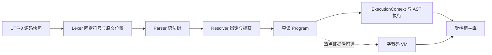

# ZZY 设计详细版

作者：赵梓伊｜更新：2026-10-09｜核心语法：v0.6｜标准库：v0.6.1｜绘图扩展目标：sketch 1.0

本文是项目完整设计总览，供实现、评审与交接使用。它归纳各专题的关系与取舍，不重复维护整套 EBNF 或接口表。当前P00—P07及P09应用业务已有实现和真实CLI/宿主测试，基准报告与校园任务管家分别提供证据；本文其他设计示例未逐一验收。编程入门见 [开发指南](../skills/guide.md)，文件导航见 [README](README.md)。

## 1. 目标、范围与文档职责

ZZY 是以赵梓伊名字命名的通用脚本语言，使用 Python 实现自己的词法分析、语法分析、名称解析和执行器。Python 是宿主工具，ZZY 是用户编写测试与应用的语言；不通过全局替换关键字再执行 Python 源码。

项目需要同时满足基础语言、自动黑盒测试、性能比较、人和 Agent 指南、完整应用、真实 Git 历史及线下演示。不可修改的 [requirement.md](requirement.md) 是作业原文；设计与扩展只能补充，不能减少交付要求。

| 作业评分部分 | 设计对应 | 交付证据 |
|---|---|---|
| 解释器，20 分 | 整数/字符串、数组/结构、I/O、分支/循环、函数 | 可运行解释器源码与 CLI 黑盒结果 |
| 自动测试，20 分 | 用 ZZY 编写的测试集，一条命令执行 | 输入、输出、诊断、退出码、数量和失败汇总 |
| 性能，10 分 | 同功能 ZZY/Python 脚本，明确比较范围 | 环境、版本、原始测量、结果校验和报告 |
| 语法与指南，20 分 | 正式契约、人用指南、Agent 指南 | 与实际接口一致的文档及已运行示例 |
| Agent 应用，30 分 | 不少于 200 行的完整 ZZY 应用 | 应用源码、实际流程、行数和真实开发记录 |

八项提交材料还包括 Git 历史和系统介绍 PPT。文档、宿主解释器或网页行数不能代替 ZZY 应用规模；性能比较不要求 ZZY 必须快过 Python。

| 内容 | 精确规则或执行依据 |
|---|---|
| 核心语法、语义、错误与位置 | [language/syntax.md](language/syntax.md) |
| 核心库的签名、效果、转换 | [language/stdlib.md](language/stdlib.md) |
| A 集合查询 | [features/query.md](features/query.md) |
| C 状态机、D 精确数量 | [features/machine-units.md](features/machine-units.md) |
| E 完整画笔扩展 | [features/sketch.md](features/sketch.md) |
| 创新归类与取舍 | [features/innovation.md](features/innovation.md) |
| 实现流程、性能与稳定性 | [runtime/interpreter.md](runtime/interpreter.md)、[runtime/performance.md](runtime/performance.md) |
| 阶段、任务状态、验证、证据 | [roadmap](development/roadmap.md)、[todo](development/todo.md)、[覆盖计划](development/test-coverage.md)、[开发记录](development/development-log.md) |

用户新指示优先。syntax/stdlib 与各专题维护对应规则，design 两版只解释它们；遇到冲突先核对契约，不把摘要当作另一套语言定义。

## 2. 核心语言：写法与基础数据

### 2.1 源码与语句

文件扩展名 `.zzy`，编码 UTF-8，接受开头 BOM 与 LF/CRLF。块用 `{}`，普通语句用 `;`；函数、结构、状态机和控制块结束后不另加分号。关键字及预置类型使用半角括号，库函数是普通名称调用。

| 写法 | 含义 |
|---|---|
| `(zno) name := value;` | 初始化后禁止这个名字重新绑定 |
| `(zyes) name := value;` | 允许名字重新绑定 |
| `name <- value;`、`a[i] <- value;` | 赋值，与初始化分开 |
| `==` | 比较，与赋值分开 |
| `(addnew)` | 具名函数或单表达式匿名函数 |
| `(zif?:)`、`(zzif?:)`、`(zzyf:)` | 分支、后续分支、兜底 |
| `(while)`、`(for)`、`(break)`、`(continue)` | 循环与循环控制 |
| `(shape)`、`Type::{...}`、`(with)` | 固定结构、实例构造、浅层更新 |

`(zno)` 只约束绑定，不递归冻结它指向的数组或结构。初始化的可变对象可以被多个名字共享；赋值目标、参数类型和冻结/归属仍走统一检查。

### 2.2 注释与字符串

单行注释为裸 `zzysay:` 到行尾，多行为裸 `zzysayalot:` 到完整结束词 `zzyend`；不加括号、不嵌套，字符串中不识别。独立结束词或未闭合正文给出词法诊断，`#` 不作为 ZZY 注释。注释只维护源码位置，不进入执行树。

普通字符串用 `[OoO]n/t/r/q/b` 表达换行、制表等转义，`[OoO][OoO]` 表达标记本身；反斜杠是普通字符。`(raw)` 跳过转义，但不能借此跨物理行或绕过字符串结束双引号。`/` 保留除法与 URL 原字符用途。

转义只在加载源码时解码一次，运行时输入、JSON、打印和已解码字符串不再扫描标记。Token 与 AST 保存原始 Unicode 码点的半开区间 span，解码后仍能定位到原文。

### 2.3 类型、集合与结构

核心包括 Int、有限 Float、Bool、String、Null、Array、Map、Function、Result、Lazy、Range、Machine、Quantity 及自定义 shape。Bool 不视为 Int，Int 注解不隐式满足 Float 注解；条件与逻辑操作必须使用 Bool。普通混合数值运算按契约处理，不把大整数比较先转 Float 而丢精度。

数组下标为非 Bool 的非负 Int；字面数组每次求值新建，别名共享内容。遍历中允许替换元素，禁止增删/重排，任何别名或宿主入口都必须在修改发生前拒绝；结束或错误退出释放活动遍历计数。Range 保存边界，不预先展开整个数组。

结构字段固定，默认表达式在定义环境中每实例求值；默认 `[]` 新建数组，默认引用外部数组仍共享。`(with)` 创建浅副本，仅替换指定字段，不重跑默认值；应用若记录历史，不能误以为嵌套可变对象也已复制。

容器、结构、函数、Lazy、Machine 以身份比较；Result 按标签和载荷规则比较，Range 按边界，Quantity 按精确值和量纲。内容一致的两份数组也可能不是同一对象，黑盒测试须明确比较目的。

### 2.4 函数、作用域与求值顺序

函数固定位置参数，不支持默认参数、关键字参数或可变参数。具名函数未显式返回时得到 Null；有返回注解时仍须检查这个值，不能绕过返回类型约束。匿名函数只接受单表达式，具名函数自递归可用，未预声明的相互递归不支持。

名字按词法位置先声明后使用，内部作用域可遮蔽外部名称。每次调用、块进入和 for 迭代建立独立绑定；函数和 Lazy 捕获可变绑定共享 Cell，普通未捕获局部用槽位。捕获不可重绑定的引用不代表引用对象被复制。

调用按“被调用表达式 → 实参从左到右 → 可调用/数量/类型检查”执行。赋值先捕获接收者和下标、检查可写，再求右侧，提交前复查最终下标/类型。优化必须保留这些顺序，包括出错前已经发生的可见副作用。

## 3. 当前核心特色：结果、延迟与管道

### 3.1 Result 把可恢复失败变成数据

`(^_^)(value)` 表示成功，`(T_T)("message")` 表示业务失败；`(?_?)` 求目标一次并按分支匹配。未命中且无兜底是诊断，`_` 只能是最后一个唯一兜底。

显式标注返回 Result 的具名函数可使用后缀 `?`：成功取载荷，失败立即返回原失败。顶层、匿名函数与 Lazy 内不能直接借用这个传播控制流。可预期 I/O/格式失败可返回 Result；类型、语法、资源或不合法操作仍中止执行，不吞成普通业务失败。

### 3.2 Lazy 显式推迟一次计算

`(zzz)(expression)` 保存表达式及捕获环境，`wake` 首次唤醒才计算；状态分为未求值、求值中、已得到值、已缓存普通错误。循环唤醒给出诊断。

首次计算读取当时捕获的绑定，之后缓存值或引用；数据变化不自动刷新，需要创建新 Lazy。它不是后台线程。资源/取消中止不能永久缓存成普通失败，相关临时执行状态要释放。

### 3.3 管道只传递一次

`source ~> function(@, other)` 用唯一的直接参数插槽表示数据流。每阶段只允许一个直接 `@`，不能藏在其他实参的嵌套表达式中；左侧只求值一次，再按约定计算函数与其他参数。

管道提高可读性，不自动合并任意回调。带副作用的筛选、映射不能为了减少遍历而改变调用顺序、错误位置或次数。

## 4. 已选 A/C/D：新增语义机制

### 4.1 A：集合查询

`?>` 把筛选、排序、截取与提取写成明确的查询：

```text
(zno) selected := tasks ?> {
    (keep): (not) @.done;
    (order): @.priority (desc);
    (take): 2;
    (yield): @.title;
};
```

此片段假设 tasks 是已有的任务结构数组。输入求值一次并建立有界浅快照，take 一次求值；按原序完成 keep，然后为所有保留项求一次键、校验并稳定排序，再截取，最后按结果序求 yield。take=0 仍执行筛选及排序校验，跳过 yield；不能擅自提前结束或 top-k。

条目采用封闭 AST 规则和实际原生函数绑定白名单。允许的纯调用有限，遮蔽后的同名函数不能放行；I/O、用户动态函数、Lazy、状态发送与其他副作用不进入条目。键支持统一数值、String 或相同量纲 Quantity，Bool 等不允许。

查询返回新 Array，不自动刷新。可以封装成普通具名函数，由现有模块导出；不另造查询编译 API。完整顺序、优先级和纯性见 [query.md](features/query.md)。

### 4.2 C：状态机

```text
(machine) Progress {
    todo -- "start" --> doing;
    doing -- "finish" --> done;
    done -- "reopen" --> todo;
}
(zno) progress := Progress("todo");
(zno) outcome := progress << "start";
```

定义是合法变化表，实例有独立状态。准备阶段拒绝重复“来源状态+事件”，构造时必须显式给出已知初始状态。`.state` 只读，状态通过发送事件改变；成功 Result 准备好后再提交状态，非法事件返回失败并保留原状态。

第一版不包含动作回调、条件守卫或并发队列。转移表可准备一次复用，实例归执行上下文；别名共享状态，冻结检查不能绕过。应用历史保存状态字符串快照，不保存一个仍会变化的实例引用。

### 4.3 D：精确数量

`2::s + 500::ms` 精确等于 `2500::ms`，`2::s + 1::m` 拒绝量纲不符，`10::m / 2::s` 产生速度量纲。Quantity 保存约分有理数和长度/时间维度，不是在普通数字后拼显示文字。

固定单位为时间 ms/s/min/h、长度 mm/cm/m/km、无量纲 one；不引入温度、货币、px 或 deg。同量纲才能加减/比较，乘除组合量纲，无量纲结果仍是 Quantity；不用于数组下标、Range 或整数整除/取余。

数量小数字面从原文精确构造，普通 Float 保留二进制语义；运行时 Float 转数量使用其实际比值，两者不能当作同一精确来源。约分、交叉乘法及中间空间有资源边界，Python 对照也使用等价有理数和维度检查。C/D 完整规则见 [machine-units.md](features/machine-units.md)。

## 5. 已选 E：完整画笔扩展

### 5.1 目标与语言接口

ZZY Sketch（梓伊小画室）借鉴 turtle 的移动、转向与抬落笔，设计目标还包括路径/填充/文字、多画笔/图层、对象编辑、撤销/重做、确定回放、SVG/项目文件、图案函数库和鼠标/键盘/定时交互；PNG 单独注明可选依赖。

sketch 使用普通库调用，登记 Canvas、Pen、Layer、Color、Drawing 等 qualified 原生类型，不新增 Token、单位或任意 Python 属性访问。句柄受执行上下文归属和冻结约束，图层锁定统一拒绝写入。坐标中心为原点，x 向右、y 向上，角度逆时针，初始画笔朝东。

### 5.2 模型、历史与复用

| 部件 | 职责与关键约束 |
|---|---|
| 绘图模型 | 保存统一几何和样式；窗口、SVG、回放复用同一记录 |
| 填充草稿 | 一次仅一个画布草稿，检查连续路径；结束后整体提交，取消恢复此前状态 |
| 文档历史 | 全画布统一记录，恢复几何和画笔/图层状态；增量记录，不每笔复制整画布 |
| 回放 | 读取已经发生的记录，不重新运行随机数、输入或回调 |
| Drawing | 不可变图案快照，可共享只读路径块；不包含窗口、回调、背景或画笔句柄 |
| stamp | 正比例缩放、逆时针旋转及平移，作为一次组合操作插入；保留原画笔状态 |
| 文件与函数库 | 严格 schema 与原子发布；导出普通 Result 函数及私有 Lazy 解码缓存 |

有界历史满时在提交前给资源诊断，清历史是显式操作，不偷偷丢失旧记录；分组不是通用事务，不能回滚 I/O。对象标识新建后不复用，撤销恢复原对象标识。

导出函数库先生成合法字符串及名称，再用真实 Lexer/Parser/Resolver 检查，之后才发布文件；check 只分析，不解码 Lazy 或绘图。导出的库不重跑原画图脚本，不使用 eval/exec。

### 5.3 窗口、事件与清理

默认 headless，普通 CLI/check/test 不初始化 Tk。GUI 模式下，Tk 主线程处理窗口/输入，独立 ZZY 执行线程独占 ExecutionContext；两侧交换有界的复制后或不可变消息，主线程不访问 Cell/Lazy 或回调进入 ZZY。

定时器采用正时间 Quantity，按宿主分辨率上取整，迟到事件合并避免追赶风暴。队列溢出给资源诊断并停止会话；关窗/取消使用独立控制路径，循环、调用和批量宿主操作检查取消。不能声称线程能强制中断任意阻塞调用，强制隔离另用进程。

上下文结束清理视图、回调、定时器和队列；关闭窗口保留文档。SVG/项目/函数库可无窗口导出，保存先生成有界内容，再独占创建同目录临时文件、关闭并替换；失败保留旧文件，不承诺断电持久性或并发事务。

完整 66 个接口及 SKETCH-01—06 以 [sketch.md](features/sketch.md) 为准。E1 核心/headless、E2 视图/图层、E3 历史/图案库、E4 交互/文件/验证须全部完成后才称完整 1.0。A 可处理普通图层快照，C 可管理工具状态，D 可提供计时间隔，均不扩展查询白名单或核心单位表。

## 6. 解释器架构与性能设计

### 6.1 前端与执行链



Lexer 按当前位置及最长匹配识别固定符号、注释和字符串，不逐字符查询类型、状态图或量纲。Parser 使用递归下降与分层表达式解析/Pratt，建立结构化节点；Resolver 提前处理名称、控制流、查询纯性、状态图和捕获。

优先完成可验证的 AST 树遍历基线：P01/P02 可用名字表，P03 完成局部槽位与捕获，P07 再测量和改进。可变绑定被函数、Lazy 或结构默认表达式持有时须保留同一绑定；自递归函数另需正确初始化自身引用，不能在创建前复制函数值。已知字段可以编号访问，但仍检查实际结构身份。宿主快速调用按实际绑定确认，遮蔽时保留通用路径。

### 6.2 程序复用与状态隔离

只读 Program 保存 AST、原文位置、布局及依赖信息；ExecutionContext 保存本次变量、模块实例、Cell、数组、Lazy、Machine、画布等。结构布局及默认表达式 AST 可以共享，携带默认值捕获环境的运行时结构定义则属于本次上下文。Program 缓存不能保存上次运行结果或可变模块。

缓存键包含规范路径、源码/依赖内容、语言版本、编译选项和宿主 ABI；计算哈希与编译使用同一字节快照，避免检查和使用不同文件内容。缓存总容量有界，依赖变化失效；不池化仍被闭包持有的工作帧。

`check` 可以递归准备依赖，但不能执行模块初始化、默认值、普通表达式、I/O、GUI 或 Web。各次运行与测试重新创建上下文，模块在同一上下文初始化一次，循环导入拒绝。

### 6.3 优化优先级与测量范围

| 方案 | 可减少的成本 | 正确性边界与实施条件 |
|---|---|---|
| 固定 Token、一次字符串解码 | 重复判断/转换 | 保存原文位置；长拼写本身不保证更快 |
| 槽位与字段布局 | 反复按名字查找 | 闭包、遮蔽、每轮绑定和动态类型不变 |
| 紧凑 Range、减少临时对象 | 不必要分配 | 保留求值顺序和共享身份 |
| 宿主批量库 | 每项 ZZY 节点执行 | 类型/修改/回调检查不绕过 |
| array.stats 一次遍历 | 分开统计的重复扫描 | 当前 sum/stats 仅 Int，空 min/max 为 Null |
| 有界 Program 缓存 | 重复解析与解析名称 | 与可变运行状态分开，按完整快照失效 |
| 常量折叠 | 重复纯常量计算 | 超预算或计算失败保留原节点，不在 check 提前报运行错误 |
| 查询索引与键缓冲 | 中间对象和重复求键 | 固定阶段、稳定排序、错误顺序不能变化 |
| 数量交叉约分 | 过大中间整数 | 中间分配仍有界，精确性不降为 Float |
| 数组校验缓存、VM/快路径 | 特定重复验证或解释热点 | P10 候选，有热点和对照证据后实施 |

语言设计会影响扫描：更长源码要读更多字符，复杂符号和注释模式也有识别成本；准备后的循环不重新扫描源码。查询排序、数量约分和绘图历史则主要增加运行/内存成本，应分别测量，不能只比较关键字长度。

必需基准包括同算法 ZZY/Python、等价库调用、优化前后 ZZY 三类对照；分别报告完整启动和准备后的执行。计时外核对结果，明确输入重建/状态复位范围，记录预热、重复次数、中位数/离散程度、版本和原始数据。分析热点与正式计时分开。

绘图基准按生成、记录、渲染、撤销/定位、导出与内存拆分，区分首次/命中缓存；与 Python 对照相同几何和历史工作，不能用 turtle 动画延时证明解释器更快。所有收益当前待测，详细契约见 [performance.md](runtime/performance.md)。

## 7. 标准库、模块、资源与诊断

宿主接口使用固定注册表，登记签名、类型、效果、归属、错误与 ABI。核心命名空间为 io、array、text、math、data、unit；禁止任意 Python 反射和 eval/exec。map/filter 每次回调经过统一 ZZY 调用，filter 要求 Bool。

JSON 采用严格标准格式，拒绝重复键、非有限数、孤立代理项、循环引用和不支持值；特别检查解码后 Float 溢出。通用 JSON 不隐式序列化 Function/Lazy/Result/Range/Machine/Quantity 或绘图原生句柄，后者使用显式绘图 schema。

`io.write_text` 是普通写入；`io.write_atomic` 使用宿主独占临时文件和替换。可预期 I/O 返回 Result，类型/资源错误仍是诊断。应用持久化采用原子发布，不把普通 write_text 宣称为事务。

模块路径相对导入文件，规范化后按上下文复用；仅导出顶层具名函数、结构和状态机定义，不导出普通绑定/实例。用户模块可以封装查询函数、组合画法，跨文件调用不额外生成新语法。

源码、数字、Token、嵌套、依赖、调用、容器、缓存、输出与绘图记录都在分配前或过程中设限。核心资源限制从 P00—P05 落地，不等待可选 P10 请求步数配额。资源/取消清理遍历计数、临时状态、句柄和会话，不泄漏宿主堆栈。

退出码约定为成功 0、运行或测试失败 1、前端/CLI/源码 I/O 错误 2、用户 Ctrl+C 取消 130；E211 资源错误按前端或执行阶段返回 2/1。sketch 不合法操作用 E214，冻结/归属写入用 E203；其余诊断按 syntax 的稳定编号和原文 span。

## 8. 应用、测试与 Agent 使用

默认 P09 应用为 ZZY 校园任务管家，提供增删改、完成状态、分类/优先级筛选、搜索排序、统计、导出、JSON 保存加载、输入恢复及简单撤销。可拆多模块，建议 250—350 行有业务意义的 ZZY；实际验收仍至少 200 行，不以注释空行凑数。

历史使用新 Task 与数组快照，避免原地修改已保存状态；可变嵌套字段另定复制策略。E 支持另建绘图应用，但不自动替代默认 P09，宿主窗口行数不计 ZZY 应用。

从 P01 起写真实 CLI 黑盒：正常/边界用 ZZY spec，非法源码也保存为 .zzy，运行器比较 stdin/stdout/stderr/退出码和必要状态。每例重建环境；空收集、坏清单、超时或输出超额均失败，双管道有界读取，取消后回收子进程树/句柄/临时目录。

固定答案与变形关系结合，不能只让两个可能有同一错误的函数互相证明。绘图增加几何、SVG/项目、撤销和导出库用例；线程/故障注入在宿主层补充，GUI 必须另有真实平台验收，headless 通过不等于 GUI 通过。

人用文档已建立为 [skills/syntax.md](../skills/syntax.md) 与 [skills/guide.md](../skills/guide.md)，AI 指南为 [skills/zzy/SKILL.md](../skills/zzy/SKILL.md)，按任务引用 docs 的正式契约；当前核心、P04 特色及 P05 库/模块示例已有验证，完整指南逐段验收仍属 P06，后续扩展仍未实现。实现后能力清单由注册接口与启用状态生成，未实现接口不得成为“已验证示例”；结构化诊断辅助 Agent 定位，真正修复由测试确认。开发记录保存实际任务、修改、失败和验证，不伪造 Agent 历史。

## 9. 开发阶段与后续取舍

核心执行顺序为 **P00 → P01 → P02 → P03 → P04 → P05 → P06 → P07 / P09 → P11**。P07 测量与 P09 应用可交错进行；阶段编号是稳定标识，P08 并不排在 P09 之前。

| 路线 | 范围 | 与主线关系 |
|---|---|---|
| 核心作业 | P00—P07、P09、P11 | 必需交付，当前下一项 P06-01 |
| 已选画笔 | P05/P06 后 E1→E2→E3→E4 | 完整 sketch 1.0 的全部阶段均要验证 |
| 可选互联 | P05/P06/P09 后 P08 | HTTP/JSON、Python 嵌入、SQLite，不阻塞 CLI |
| 条件优化 | P10 对应基础完成后 | 数组校验缓存、schema、配额、VM 等独立候选 |

Web 使用 Python 适配 HTTP，ZZY 执行业务，每请求独立上下文；共享捕获环境递归冻结，拒绝共享模块级 Lazy/可变闭包，业务状态放数据库。HTTP 超安全范围整数采用显式 String 字段协议，不能随数值大小自动改 JSON 类型。

shape 驱动接口合约、请求步数配额、纯函数缓存和版本切换仍是候选；自动依赖刷新 B、其他动漫/游戏场景未采用。未完成扩展明确写设计/子集/延期，不冒充已实现，也不减少作业材料。

阶段细项、依赖与完成标准见 [roadmap.md](development/roadmap.md)；70 项代码任务仍全部未完成，以 [todo.md](development/todo.md) 为唯一状态清单。P11 核对八项交付物、真实性能报告、Git 历史、PPT 及新环境演示。

## 10. 借鉴与创新表述

创新重点是 ZZY 特色写法、明确语义、查询/流程/量纲机制，以及画笔与图案库的完整组合，不宣称世界首创或预先保证性能和评分。

已有设计借鉴资料包括 [Rust 可变绑定](https://doc.rust-lang.org/book/ch03-01-variables-and-mutability.html)、[Result](https://doc.rust-lang.org/book/ch09-02-recoverable-errors-with-result.html)、[Elixir 管道](https://hexdocs.pm/elixir/Kernel.html#%7C%3E/2)、[Racket 延迟求值](https://docs.racket-lang.org/reference/Delayed_Evaluation.html)、[Crafting Interpreters 源书](https://github.com/munificent/craftinginterpreters/tree/master/book) 和 [Python turtle](https://docs.python.org/3/library/turtle.html)。专题保留各自参考链接；借鉴不是实现证据。函数契约、通用带标签值、字符串插值等未纳入当前核心契约。

## 11. 从设计到实现的补充约定

| 补充 | 唯一细则来源 | 为什么需要 |
|---|---|---|
| 资源配置与失败边界 | [resources.md](runtime/resources.md)，default-v1 | 将“需要有上限”落实为计量单位、默认值、检查阶段、配置指纹与清理；容量限制不等于时间限制 |
| 可实施基准 | [performance.md](runtime/performance.md) 第 3.4/3.5 节 | 固定 B01—B09、规模、答案与计时范围，保证前后对照可重现；P07 内部驱动不依赖 P08 |
| 应用保存和恢复 | [campus-app.md](development/campus-app.md)，schema_version=1 | JSON 可解析不等于业务合法；全量校验后替换，失败保留旧文件/内存，明确 ID 和撤销行为 |
| 人和 Agent 的诊断样例 | [diagnostics.md](language/diagnostics.md)，schema_version=1 | 统一坐标、JSON Lines、退出码与修复提示，缺文件不伪造源码位置 |

应用校验暴露出一个核心库缺口：任意 JSON 值不能先强行当 Map/Task，再靠致命类型错误恢复。因此 stdlib v0.6.1 新增 `data.kind(value)`，仅返回 JSON 基础类别及 other，不暴露宿主反射、不解包或唤醒值，也不扩展查询白名单。应用业务仍由 ZZY 编写。

实现环境要在 P00 固定 Python/Unicode/平台的实际版本和已验证支持范围；普通文件路径相对工作目录，use 路径相对导入文件。运行器验证中文/空格路径，核心依赖与可选 GUI/Web 依赖分开。对应要求进入现有 P00/P05/P06/P07/P09/P11，保持原任务编号和未完成状态。

补充设计也有验证边界：资源数值尚待真实实现校准，诊断示例不是实际 stderr，JSON 样本不是应用输出，基准清单不是实测报告。P11 仍须在新环境重跑，未支持的 GUI 或扩展明确列出，不能仅凭这些文档声明可用。
