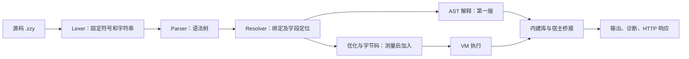
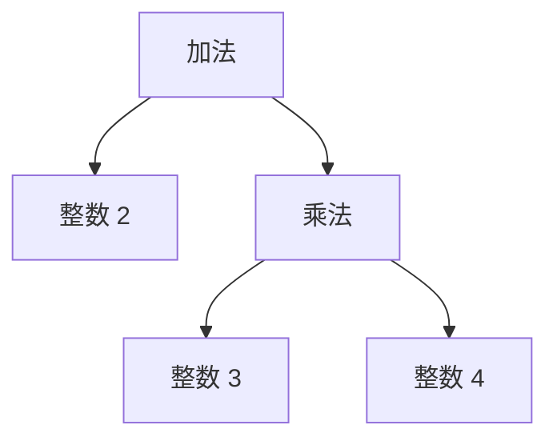

# ZZY 解释器实现流程

作者：赵梓伊｜更新：2026-10-10｜状态：v0.6 语法实现路线；P00/P01 最小执行链与非执行 check 已实现

当前语法以 [syntax.md](../language/syntax.md) 为准，整体方案见 [design详细版.md](../design详细版.md)，库以 [stdlib.md](../language/stdlib.md) 为准；优化与后端扩展见 [performance.md](performance.md)。本文回答“先写什么、每一步产生什么、怎样证明做对了”，不把规划中的代码和命令当成已有功能。Web 为可选扩展，完整 CLI 应用不依赖 Web 或 VM。

本文的“第几步”按部件说明完整架构，不是要求一次写完一个部件再开始执行。实际依赖以 [roadmap.md](../development/roadmap.md) 为准：P01 用最小 Lexer/Parser/名字表/执行器跑通输出，P02 补数据与控制流，P03 完善 Resolver、槽位与闭包，P04/P05 补特色和库；P06/P07/P09 完成测试、性能和应用。VM 按 P10 的热点证据选择，Web 属于 P09 之后的可选 P08。

P01-02 实际实现为 ast_nodes.py、parser.py、prepare.py、interpreter.py：不可变节点保留 Token 位置与完整表达式范围，prepare 完成整个文件的顶层名称检查和 Int 字面转换，Interpreter 建立新的绑定表并树遍历执行。当前只支持 README 所列最小子集和 io.print；run 执行、check 完成 prepare 后直接返回，二者前端一致；check 不构造 Interpreter。调用保持普通表达式语义，不把 io.print 硬编码成特殊语句。完整 Resolver/槽位/闭包仍按 P03 推进。

阅读方式：每一步先看“形象理解”，再看实现细节，最后看“选择与性能”。先理解它做什么，再决定要不要优化。表中的性能收益是待验证的方向，不是已经测出的提升。

## 0. 先认识宿主 Python：用什么造出 ZZY 的执行机器？

Python 是实现解释器的工具。我们用 Python 编写读取源码、识别关键字、保存变量、执行函数和报告错误的程序；这个程序能够运行 ZZY，因此称为 ZZY 解释器。

像用中文写一份“外星语翻译手册”：中文是编写手册的语言，外星语是手册要处理的语言。对于本项目，Python 是实现工具，ZZY 是用户写应用的语言。

```text
你写的 ZZY 程序
    -> 用 Python 编写的 ZZY 解释器读取并执行
    -> 利用 Python 的存储、计算和库完成操作
    -> 显示结果或返回给前端
```

例如 ZZY 写 `(zyes) total := 0;`，Python 本身不认识这条语法。我们必须在解释器里实现规则：“识别可变声明，创建名为 total 的绑定，存入整数 0。”

因此要编写两种代码：解释器使用 Python，应用和测试使用 ZZY。Python 帮我们完成底层工作，但 ZZY 的变量、数组、转义和错误规则由我们自己决定。它不意味着用户的 ZZY 源码自动变成普通 Python 源码。

## 一段程序怎样经过整条流水线？

以下面的两条 ZZY 语句为例：

```text
(zyes) total: (Int) := 1;
total <- total + 2;
```

| 环节 | 形象理解 | 发生的变化 |
|---|---|---|
| 入口 | 接收订单 | 读入 `.zzy` 文本，确定运行还是检查 |
| 词法 | 给小积木贴标签 | 识别 `(zyes)`、变量名、整数、加号等 |
| 语法 | 把积木拼成说明书 | 得到“声明 total”和“给 total 加 2” |
| 名称解析 | 安排编号抽屉 | 将 total 对应到某个绑定或存储编号 |
| 执行 | 按说明书操作 | 将 1 放入抽屉，再把 3 放回去 |
| 优化 | 简化重复动作 | 减少按名字寻找和多层节点分派 |

这段程序不会自行输出；加入 `io.print(total);` 才会显示 `3`。通常一次运行只读和解析一次源码，之后循环执行已经准备好的程序表示。

## 1. 路线：先得到正确结果，再优化执行

**形象理解：先让厨房按照菜谱做对菜，再优化出菜速度。** 菜谱写得可爱不影响厨师理解后采用固定操作；同样，`(zif?:)` 在前端处理后就是普通分支，不需要执行器反复看懂问号表情。



普通运行按这个顺序处理一个文件；后端服务器在启动时完成加载、解析和定位，请求到来时复用程序表示，建立新的执行状态并调用处理函数。

建议保留能解释清楚的 AST 初版作为基线。字节码不需要一开始完成全部功能，先根据实测热点决定是否值得增加第二个执行后端。

**总的选择与性能：** 第一版保留明确的阶段，容易诊断和测量；后续可以将部分阶段合并，但不能只因为“步骤少”就认定更快。词法和语法通常影响加载成本，变量访问、调用与指令分派影响重复执行，库与数据布局影响批量处理。

## 2. 第一步：确定文件和对外接口

**形象理解：先设一个接待窗口。** 用户说“运行这个文件”“检查这个文件”或者“测试全部文件”，入口把任务交给后面的处理流程。入口本身不负责理解循环或函数。

例如收到 `run hello.zzy` 后，入口读取文件，然后交给 Lexer；收到 `check hello.zzy` 则完成检查就停下，不能把打印语句执行出来。

```text
zzy/
    __main__.py          # 命令行入口
    source.py            # 源码、偏移和行列位置
    tokens.py            # Token 类型
    lexer.py             # 词法和字符串解码
    ast_nodes.py         # 语法树
    parser.py            # 语法分析
    resolver.py          # 名称、槽位、控制流合法性
    values.py            # 数组、结构、函数、Result、Lazy
    runtime.py           # 栈帧、绑定、内建调用接口
    interpreter.py       # AST 执行
    diagnostics.py       # 统一诊断
    native/              # Python 实现的批量库
    test_runner.py       # 黑盒测试
    optimizer.py         # 后续：常量折叠
    bytecode.py          # 后续：指令定义和编译
    vm.py                # 后续：字节码执行
    web_adapter.py       # 后续：Python Web 桥接
tests/
examples/
benchmarks/
```

CLI 约定（run/check 已实现最小子集，test 待实现）：

```text
python -m zzy run examples/hello.zzy
python -m zzy test tests/
python -m zzy check examples/hello.zzy
```

`check` 读取源码及依赖后，只解析、解析名称和检查合法性，不执行程序或模块初始化；运行时类型约束仍需执行时检查。诊断统一包含错误码、文件、行列和消息；成功退出码为 0，运行时错误或测试汇总失败为 1，单文件前端分析、命令参数或源码读取错误为 2。测试中的预期非法源码仍按清单比对，匹配预期不计为失败。

P00 就建立统一资源/中止信号，源码、Token、数字长度、嵌套、依赖和输出在分配前或过程中受限；前端 E211 退出 2，运行 E211 退出 1，不等待 P10 才防止无界分配。读取同一字节快照用于哈希与编译，避免缓存拿旧哈希配新文件。行起点索引一次构建，位置换算按偏移查索引，不逐条诊断重扫全文。

具体数值、配置和取消出口以 [resources.md](resources.md) 的 default-v1 为准；文本/JSON 诊断布局和源码定位示例以 [diagnostics.md](../language/diagnostics.md) 为准。Ctrl+C 清理后退出 130，区别于容量 E211 和测试运行器汇总失败 1。源码 BOM/CRLF、Unicode 码点列号与 EOF 位置在 source.py 统一处理。

P00 同时固定运行环境和路径：记录实际 Python 实现/完整版本、Unicode 数据版本与平台；在项目配置写明经过验证的支持范围，未测试版本不声明兼容。核心只依赖标准库，GUI/Web/PNG 等单独列可选依赖。CLI 源文件参数、普通 io 文件路径、资源配置路径相对进程工作目录；use 仍相对导入文件。解释器不偷偷 chdir，测试用例显式指定工作目录；中文及带空格路径进入 CLI 验证。入口源文件和 use 目标统一规范化身份，以识别同一文件的不同相对路径与链接别名，规范化/读取失败仍 E401。

前端分层仍需提供可独立调用的内部准备/执行边界，供 check、黑盒运行器和 P07 基准共用。P07 不等待可选 P08 的公开嵌入 API；内部辅助函数只组织上下文、调用与计时，不替 ZZY 执行被测业务算法。

完成标志：入口能读取 UTF-8 文件，文件缺失能给出清楚的错误；这些还不算已经实现语言功能。

**可增加的选择与性能：**

| 选择 | 为什么可能有效 | 先做哪一种 |
|---|---|---|
| 每次命令启动一个进程 | 状态独立、调试简单，但会重复支付启动成本 | 第一版采用 |
| REPL 或长期运行的服务 | 同一 Python 进程接收多个任务，摊薄启动和模块加载成本 | 后端阶段采用，任务状态仍需隔离 |
| 按命令加载依赖 | 普通脚本不提前加载 Web 框架或 NumPy | 优先做，可缩短普通命令启动时间 |

长期进程复用的是工具和只读程序表示，不是默认复用上一次请求的变量。依赖拆分提升的是启动体验，不会自动让加法变快。

## 3. 第二步：词法分析，把字面写法变成 Token

**形象理解：把句子切成带标签的小积木。** 比如看到 `(zyes)`，贴上“可变声明”标签；看到 `total`，贴上“名字”标签；看到 `0`，贴上“整数”标签。Token 就是这样的带标签积木。

这一阶段认字，不计算。它知道 `+` 是加号，却不会马上做加法；看到 `"A[OoO]nB"` 时会解码字符串，把源码写法转换为真正包含换行的文字。

输入：源码文本。输出：Token 列表，每个 Token 保存类型和原始位置；字符串保存解码后的值，数字保留原文片段，在 Parser/准备层识别普通数或 Quantity 后转换一次。

例如：

```text
(zyes) total: (Int) := 0;
```

得到：

```text
MUTABLE_DECL  IDENT(total)  COLON  TYPE_INT  INIT  INTEGER(0)  SEMICOLON
```

具体实施：

1. 维护固定符号表：`(zno)` 对应不可重新绑定声明，`(zyes)` 对应可变声明，`(addnew)` 对应函数，`(zif?:)` 对应分支。
2. 按首字符选择扫描逻辑；`(` 开头时用固定名单或前缀树识别完整关键字、颜文字，未命中时就是普通左括号。符号数量固定，不在每个位置反复扫描所有表达式。
3. 对 `:=`、`::`、`..<`、`<-`、`~>`、`-->`、`--`、`<<` 等使用最长匹配；`(zzif?:)`、`(zzyf:)` 作为完整 Token，内部问号、冒号不再拆分。
4. 识别整数、小数、标识符和分号。正常源码读到完整标识符 zzysay/zzysayalot 且下一字符紧邻冒号时进入相应注释模式，不从标识符中间匹配；单行跳到行尾，多行扫描到完整结束词 zzyend，不嵌套。普通/raw 字符串内不识别注释；未闭合多行注释报 E101 并指向起始标记。小数点后必须有数字，避免把 `0..<5` 误读成浮点数。
5. 进入字符串后只运行字符串扫描逻辑，内部出现 `(zif?:)` 不变成关键字。
6. 在普通字符串中将 `[OoO]n` 等解码一次。看到完整 `[OoO]` 后检查固定后缀；再次遇到 `[OoO]` 则产生字面的一个转义标记。
7. `(raw)` 后要求下一个有效词项是双引号字符串，扫描时不解码转义；缺失字符串则报错。Token 中记录字符串模式，Parser 确认原样字符串形式合法。
8. 保留源码起止偏移；出错时根据行起点索引换算位置，不能用解码后的字符串长度推算源码列号。

不要做全局替换，例如先将所有 `[OoO]n` 换成换行；它会误改注释、原样字符串和错误位置。正常字符串用字符片段列表收集，最后一次拼接，避免逐字符重复构造长字符串。

注释扫描只前进不回退，正文不生成 Token；多行的每次 zzyend 候选检查左右 Unicode 标识符边界，匹配失败从该候选之后继续，避免反复扫描相同正文。保留换行与原文 span，注释当空白处理，不把两侧词项拼接。单行 EOF 合法，多行 EOF 未闭合和正常源码中的裸 zzyend 为 E101；按 syntax 契约覆盖前缀、行内结束、字符串和未闭合场景。

完成标志：能正确区分颜文字、数组、括号与字符串；错误转义、未闭合字符串和非法字符有固定诊断。每项都通过实际源码文件验证。

P01-01 已按上述边界实现 `tokens.py`/`lexer.py`，通过 `python -m zzy lex 文件.zzy` 查看真实 Token；外部清单见 [词法黑盒说明](../../tests/lex/README.md)。Token 保留 Source 及半开偏移，只有字符串附解码值和 raw 标记；数字仍保留原文，普通数/Quantity 转换留给准备层。固定符号按首字符分流并最长匹配；每文件非 EOF Token 数、数字位数、解码字符串长度在扫描过程中检查。源码嵌套及 AST 深度现已由 P01-02 Parser 检查，不以 lex 代替语法分析。

**可增加的选择与性能：**

| 选择或创新 | 形象说明 | 收益和取舍 |
|---|---|---|
| 首字符分流 + 固定名单 | 看到 `(` 才去找括号关键字，看到数字直接读数字 | 第一版推荐，减少无关匹配 |
| 前缀树或有限状态扫描器 | 共同的开头只比较一次，再沿分支继续找 | 符号变多时值得测；小名单可能不如简单查表 |
| 无转义字符串的直接路径 | 没有 `[OoO]` 的字符串直接保存内容片段 | 减少不必要的字符拼接，解码后行为相同 |
| 保存源码偏移 | 积木只记录文字在哪，不给所有标点复制原文 | 可以减少对象内存；源码本身要保留以便报错 |

采用一次从左向右扫描，避免反复回头替换。若减少 Token 对象开销，可比较普通对象与带 `slots` 的数据对象，之后再考虑紧凑数组；布局更紧凑不保证 Python 执行一定更快。词法扫描思路参考 [Crafting Interpreters 的扫描章节](https://github.com/munificent/craftinginterpreters/blob/master/book/scanning.md)。

Unicode 起始/延续判定应基于固定长度字符检查或等价分类；不能每追加一个字符就对增长的整个名字调用 isidentifier，长标识符会产生二次扫描。仍保留 Python 对应的 Unicode 范围、不归一化，加入超长名字与大量结束词候选的线性增长测量。

## 4. 第三步：语法分析，建立 AST

**形象理解：积木有了标签，还要拼成有先后关系的说明书。** `2 + 3 * 4` 不是按看到的顺序随便算：说明书必须写清“先乘，再加”。AST 是“抽象语法树”，可以理解为这份有层次的说明书。



这棵树表示的结果是 14；Parser 负责建立这棵树，执行器才负责计算。函数定义也保存为说明书，而不是调用一次就重新阅读一次源码。

输入：Token。输出：描述程序结构的对象，例如：

```text
Declare(name="total", mutable=True, annotation=Int, value=Literal(1))
Assign(target=Variable("total"), value=Binary("+", Variable("total"), Literal(2)))
```

语句用递归下降：根据声明、函数、结构、分支、循环、匹配等起始 Token 选择解析函数；表达式用 Pratt 或分层递归下降处理优先级。

先支持字面量、变量、四则运算和调用，再增加数组索引、结构字段、逻辑短路、区间、管道和后缀 `?`。`:=`、`<-` 只在声明或赋值语句中出现，不加入任意表达式嵌套。

新的分支仍产生普通的分支 AST：

```text
(zif?:) condition { ... }
(zzif?:) another_condition { ... }
(zzyf:) { ... }
```

Parser 将其保存为有序的“条件与块”列表及可选兜底块，不把关键字的字符串传给执行器反复比较。

`(addnew) name(...) { ... }` 是具名函数；`(addnew)(x) => expression` 是匿名函数。`(zzz)(expression)` 是延迟节点，参数此时不能求值。`Type::{...}` 是结构构造，普通 `{...}` 是块，保持两者区别。

完成标志：合法程序能形成正确层次，缺分号、缺括号、缺分支块等错误能指出位置；语法分析不执行 `io.print` 或任何用户函数。

**可增加的选择与性能：**

- **先采用独立 AST。** 每种操作有自己的节点，容易阅读、定位错误和以后生成字节码；表达式优先级只需在解析时处理一次。
- **Pratt 与分层递归下降二选一。** 前者用优先级表组织表达式，后者每层处理一组运算符；两者都可实现，选择易维护的方案，不预设谁一定更快。
- **将特色写法归一化。** 三种分支写法统一保存到分支节点，管道保存为带单次临时值的调用节点；不要简单复制左侧表达式而导致重复求值。
- **以后可尝试直接生成字节码。** 跳过完整 AST 能减少某些中间对象，但实现错误提示、优化和维护通常更难。仅当加载时间或内存成为问题时再考虑。

这一阶段主要优化解析时间、表示体积和后续执行所需的信息，不靠省略语法检查提高速度。

## 5. 第四步：名称解析，提前安排存储位置

**形象理解：给变量安排带编号的抽屉。** 原来每次使用 `total`，都要拿名字去问“它在哪”；现在提前分配 0 号抽屉，执行时直接拿 0 号。

```text
解析之前：读取名字 "total"
解析之后：读取当前函数的局部槽位 0
运行时：frame.locals[0]
```

“作用域”像不同房间：两个房间可以各有一个叫 `count` 的抽屉，不能弄混。闭包像把抽屉的钥匙带出去，函数离开原房间后仍能使用那一个抽屉，而不是偷偷复制内容。

输入：AST。输出：带绑定信息的 AST、每个函数的局部槽位表、结构字段布局。

具体实施：

- 进入块时建立作用域，声明时登记名字；同块重复声明报错，内层可以遮蔽外层。
- 给参数、局部变量分配槽位，例如 `total -> slot 0`。引用节点记录它访问本地、上层闭包还是模块绑定。
- 确认名字已声明，记录 `(zno)` / `(zyes)` 与可选类型约束。直接给不可重新绑定名字赋值可提前拒绝，动态调用边界仍保留检查。
- 在解析函数体前登记函数自身，支持自递归；第一版不支持未经预声明的相互递归。
- 对被闭包或 Lazy 捕获的可变绑定分配共享 Cell，所有相关捕获者引用同一绑定实例；每轮循环创建独立绑定，避免所有回调读到最后一轮。
- 捕获分析覆盖结构默认表达式及多层嵌套函数。中间函数即使不直接使用外层变量，也要把内层函数需要的绑定传递下去；结构默认值在每次构造时读取定义环境中该绑定的当前值，不能提前冻结成定义时的值。
- 自递归的具名函数不能照普通不可变捕获直接复制尚未初始化的自身值。创建函数对象后连接其 self 引用，再完成捕获环境；或用仅内部可初始化一次的引用实现。对用户仍保持函数绑定不可重新赋值，不因此开放前向引用或相互递归。
- 检查 `(return)`、`(break)`、`(continue)` 的上下文；进入函数后重置循环上下文，不能跳出调用者的循环。
- 后缀 `?` 只允许在声明 `-> (Result)` 的具名函数内；延迟表达式中直接出现 `?` 要拒绝。
- 每个管道阶段只允许一个直接参数插槽 `@`，拒绝嵌套或重复插槽。
- 为每个结构登记固定字段编号。接收对象的结构已知时提前解析字段；未知时保留运行时查找及类型检查。

这一步是“检查 + 提前定位”，不是完整静态类型推导。它能减少执行时的名字查找，同时帮助发现 Agent 生成程序中的错误。

完成标志：作用域遮蔽、闭包共享、非法控制流、管道插槽都有黑盒用例；不会把名字简单全局替换成编号而破坏遮蔽规则。

**可增加的选择与性能：**

| 选择或创新 | 怎么实现 | 取舍 |
|---|---|---|
| 名称字典 | 每次按变量名查找 | 便于先跑通，但重复查找成本较高 |
| 局部槽位 + 共享 Cell | 普通局部直接取编号，闭包变量使用共享存储 | 推荐目标，不必给所有局部都套 Cell |
| 结构字段编号 | 已知 `Task` 的 `done` 是第几个字段，直接访问布局 | 动态对象仍需检查实际结构，不能猜错编号 |
| 稳定宿主调用编号 | 把确定的 `array.sum` 对应到内建函数编号 | 减少重复库查找；要求库命名空间不可被随意替换 |

第一版应保留动态调用的通用路径。只有能确认接收对象或库绑定时才使用直接路径。局部槽位设计参考 [Crafting Interpreters 的局部变量章节](https://github.com/munificent/craftinginterpreters/blob/master/book/local-variables.md)。

## 6. 第五步：运行时和 AST 执行，先满足基本功能

**形象理解：真正开始按说明书干活。** 将 1 放进 `total` 的抽屉，读出来加 2，再把 3 放回。前几步准备说明书和位置，这一步才改变变量、执行循环、输出结果。

“运行时”是执行所需的工作台，包括抽屉、函数调用记录和数组等对象。每次函数调用都需要自己的工作台；两次调用不能意外共用局部变量。

宿主 Python 在这里出力：用 Python 整数做算术，用 Python 容器保存槽位，用我们写的执行函数处理 ZZY 节点。但这些底层工具要服从 ZZY 的规则，不能直接把所有 Python 行为照搬过去。

建立核心值：`ArrayValue`、`ShapeDefinition`、`StructValue`、`FunctionValue`、`ResultValue`、`LazyValue`，以及函数栈帧和绑定 Cell。P01/P02 可先使用名字表，P03 后函数栈帧使用槽位列表，模块名称表用于加载与桥接。结构的字段布局和默认表达式 AST 属于只读程序；携带定义环境的 `ShapeDefinition` 在本次执行中建立，不能把旧上下文的 Cell 或默认数组随 Program 缓存共享给下一次运行。

按顺序实现：

1. 数字、字符串、布尔值、空值，声明和赋值。
2. 内建调用，先接入 `io.print`、`io.input`，形成最小完整运行链。
3. 分支、逻辑短路、`while`、数组和区间遍历，及循环控制。
4. 数组索引和修改，活动遍历期间在增删/重排发生前拒绝；跟踪结构版本和内容版本，所有别名/宿主写入走同一入口。
5. 结构构造、默认值、字段检查和浅层 `(with)` 更新。
6. 函数、返回、递归、匿名函数和闭包。

只重新绑定 `(zyes)` 名字；通过 `(zno)` 引用修改现有数组元素仍然允许。宿主 Python 中 `bool` 是 `int` 的子类，但 ZZY 的布尔值不参加整数运算；负数组索引、对象真值和类型注解也按 ZZY 规则独立检查。

普通 Int/Float 的 `/` 返回浮点结果，Quantity 除法按数量契约处理；`//` 向下取整，第一版 `//` 与 `%` 只接受整数。条件必须是布尔值。输入末尾返回空值。`return`、循环控制等使用内部信号，用户错误则进入统一诊断，不混为一谈。

完成标志：基本功能全部能通过命令行运行；函数调用不会重复解析函数源码，循环不会重复解析条件源码。

**可增加的选择与性能：**

- **分派方式可测量选择。** 比较节点方法、按节点种类查表、直接分支判断的开销；Python 中没有一种写法对所有程序都必然最快。
- **常量尽量共享，可变对象按语义创建。** 相同的只读字面量可以复用；函数中的 `[1, 2]` 和结构默认数组字面量每次新建。默认值若引用外部数组，仍共享该引用，不能暗中深拷贝改变语义。
- **区间不提前变数组。** `0..<1000000` 保存起点和终点，迭代时产生数字，省去一次大数组分配。
- **普通局部不做无用包装。** 使用直接数值与槽位，只有确实需要捕获的绑定采用 Cell；这减少对象，但不改变引用和闭包行为。
- **暂不做栈帧对象池。** 重用调用对象可能省分配，但闭包仍可能持有旧绑定，过早回收会出错。等调用分配成为热点再设计生命周期。

运行时优化直接影响重复执行；每次修改都用闭包、数组别名、默认值等用例验证结果。

## 7. 第六步：让特色功能有准确行为

**形象理解：让语言特色变成有规则的小工具。** `Result` 像贴着笑脸或哭脸的信封，里面装着值或失败原因；`Lazy` 像一张还没执行的取餐单；管道像依次经过几张工作台的数据。

例如 `(zzz)(array.sum(scores))` 先保存“稍后求和”的单子；第一次 `wake` 才做求和并存好结果，第二次直接取同一份结果。它不会知道成绩后来变了，所以不能将缓存当成自动更新的统计。

| 功能 | 具体实现 |
|---|---|
| 颜文字结果 | 保存成功/失败标签及一个载荷；失败载荷第一版是字符串 |
| 模式匹配 | 被匹配表达式求值一次，按顺序尝试，命中后建立分支作用域 |
| `?` | 成功时解包；失败时生成当前函数的返回信号 |
| 延迟值 | 保存表达式和捕获环境；第一次 `wake` 计算并缓存，之后读缓存 |
| 管道 | 保存左侧结果一次，计算右侧函数及其他参数，将结果放入唯一插槽 |
| `(o_o)` | 条件只求值一次，失败时显示原始断言及源码位置 |
| `(@_@)` | 表达式只求值一次，值及源码位置输出到标准错误流 |
| `(spec)` | 收集顶层测试，每例建立新环境，外部运行器汇总结果 |

Lazy 保存未求值、正在求值、缓存值、缓存错误四种状态；循环唤醒报错。第一次唤醒前读取捕获绑定的当前值，缓存后不自动刷新，不能默认共享请求之间的延迟结果。

完成标志：不仅有“能运行”的例子，还验证求值次数、提前返回、错误缓存和数据变化后的行为。

**可增加的选择与性能：**

| 功能选择 | 能节省什么 | 需要保持的规则 |
|---|---|---|
| 小标签表示成功/失败 | 避免运行时再辨认 `(^_^)` 的文字 | 标签之外仍保存载荷，成功值不等同于布尔值 |
| 显式 Lazy 缓存 | 跳过未使用或重复执行的昂贵计算 | 首次唤醒与缓存后行为不同，数据改变时由程序更新缓存对象 |
| 管道单次临时值 | 避免重复执行上一阶段 | 阶段顺序、回调顺序、副作用保持不变 |
| 观察工具按需使用 | 普通运行不生成额外观察日志 | 显式 `(@_@)` 仍按约定输出，不能静默删掉 |
| 专用批量管道接口 | 某些已知纯数值处理合并成一次库调用，少建中间数组 | 优先提供明确函数，暂不自动融合任意 `map/filter` |

缓存需要存储状态和结果，如果计算很便宜且只用一次，Lazy 反而可能更慢。采用小标签也只是减少表示和分派开销，不给它预先标一个提升倍数。

未来若设计自动管道融合，需先限制在能确认回调纯粹、错误与输出顺序兼容的子集；否则原来“先全部筛选、再全部转换”的程序可能变成不同的执行过程。

## 8. 第七步：注册宿主批量库和模块

**形象理解：常见工作交给准备好的专门工具。** 自己逐条解释一百万次加法，像每次都念一遍操作说明；`array.sum(numbers)` 像直接交给一台已经做好规则检查的求和工具。

用 ZZY 写的库主要让代码复用，用 Python 写的宿主库还可以减少 ZZY 节点执行开销。它们都叫库，但加速来源不一样；调用宿主库也有检查和转换成本。

先采用明确注册表：库名与函数名对应 Python 包装函数。包装函数有统一签名说明、参数校验、返回值转换和错误转换，不允许调用者自行选择任意 Python 属性。

示意流程：

```text
ZZY array.sum(numbers)
  -> 解释器检查调用和参数
  -> Python 包装函数检查整数元素，排除布尔值
  -> 按 ZZY 资源策略执行有界整数累加
  -> 返回 ZZY Int
```

不能只检查输入类型就无条件调用 Python `sum`，最后才检查结果大小：大整数累加的中间值也可能超限，即使正负抵消后最终结果很小。基线使用受限累加；只有能预先证明所有部分和及临时分配都满足相同预算时，才走宿主 `sum` 快路径。上界估计过于保守时回退逐项检查，不把“无法证明安全”直接当作新的程序错误；长批量操作仍按约定检查取消。`array.stats` 的累加同样受限。

优先实现 `array.sum`、`array.sorted`、`text.join`、JSON/文件读写和 `array.stats`，接口、空输入与副作用严格按标准库契约。当前 sum/stats 仅接受 Int；浮点 sum 与逐项加法不保证相同舍入。需要 ZZY 回调的 map/filter 经过统一调用接口，不能误当 Python 函数直接调用。

模块用 `(use) "campus.zzy" (as) campus;` 导入：准备阶段规范化路径、递归分析依赖和导出名字，并检查循环导入；`check` 到此结束。执行阶段按导入顺序初始化模块，得到包含实际值的导出表；顶层具名函数、结构和状态机定义为公开导出，内部变量不自动导出。同一运行环境内复用模块实例，不重复初始化。模块缓存与不同测试、请求的运行状态分别管理；依赖总量/深度与 Program 缓存容量受限，淘汰缓存不销毁正在执行的引用。

完成标志：宿主库与 ZZY 手写程序结果一致，传错参数不会泄漏 Python 堆栈；加载不会在每次调用时重复进行。

**可增加的选择与性能：**

| 选择或创新 | 形象说明 | 收益和取舍 |
|---|---|---|
| 一次批量调用 | 一次搬整箱数据，避免逐件往返解释器 | 最优先尝试求和、排序、拼接与 JSON |
| 少做跨边界复制 | 包装函数能读取现有数据表示时，不重复建一份列表 | 仍保留类型检查；宿主不能绕过 ZZY 的修改规则 |
| `array.stats` | 一次扫描完成多个统计 | 可能少遍历，但应与多次高效内建函数实测比较 |
| 可选同类型数值库 | 一整批数值交给 NumPy 等后端 | 大数据才可能覆盖转换成本，类型与溢出规则须明确 |
| 模块加载缓存 | 一个运行环境内导入过的模块不再重复初始化 | 不同测试或请求不默认共享可变状态 |

一个深入提案是缓存数组类型校验：保存“对象 + content_version + 谓词版本”对应的成功判定，元素替换、增删和任何宿主修改都更新内容版本。负面判定暂不缓存；别名改成 String/Bool 后必须重新检查。它只缓存类型判定，sum/stats 仍重新遍历计算。只记长度不够；第一版先完整检查，重复校验成为热点后再做，并记录命中率、写入开销与内存。

模块缓存至少区分“已解析的只读程序”与“本次运行的模块实例”。前者可复用；后者包含变量与副作用，不能为了速度混用。NumPy 批量操作的实现理念参考 [NumPy 官方介绍](https://numpy.org/doc/stable/user/whatisnumpy.html)。

## 9. 第八步：建立性能基线，再做低成本优化

**形象理解：先用秒表找慢动作，再决定换哪把工具。** 不能看到某种写法很酷就认定它更快；先量出时间花在“认字”“找抽屉”还是“计算”，才能对症处理。

“基线”是优化前的结果；“热点”是花时间最多的地方。假设测量发现 70% 时间用于变量读取，此时优先改善变量访问可能比优化只占少量时间的字符串扫描更有价值。这里的 70% 只是说明方法的例子，不是本项目实测数据。

为整数循环、函数调用和数组处理保存固定规模的基准，以及相同功能的 Python 对照程序。

1. 先核对结果；保存当前 Git 版本和原始测量数据。
2. 用 `cProfile` 查看热点，用独立计时测性能；不要把分析器的耗时当最终结果。
3. 在 P03 已有槽位、P05 已有批量库的基础上，验证调用路径和减少临时对象是否改善热点。测量槽位迁移收益时，使用保存的迁移前后版本及两者都支持的同一脚本，不把 P07 写成首次实现槽位的阶段。
4. 做保守常量折叠：只折叠合法、纯粹的字面量运算，保留源码位置；`1 / 0`、类型错误等保留到原执行位置，不能提前触发错误改变程序行为。
   候选超过折叠预算或尝试求值失败时保留原节点；只拦截候选计算的预期诊断，不吞掉编译器本身错误。不能让未执行分支在 check 时因折叠而报运行/资源错误。
5. 在同一进程中缓存只读的解析和名称解析结果，不缓存上次的变量状态。若增加磁盘缓存，键包含源码内容哈希、语言/指令版本和依赖信息。
6. 每次优化后运行原有黑盒用例，再比较同一输入的耗时与内存；看到实际收益才保留。

完成标志：性能报告能够说明“哪个任务、哪项优化、测得什么”，而非仅展示代码更短。

**可增加的选择与性能：**

- **分阶段计时。** 分别记录读文件、词法、语法/定位、执行与库调用；这样不会将加载缓存的收益误写成循环执行更快。
- **比较三种使用场景。** 新进程第一次运行、已有进程重复运行、后端请求复用程序表示；缓存命中率不同，结果不能混成一个数字。
- **每次改变一件事。** 用相同脚本分别比较名称字典与槽位、手写循环与批量库、AST 与 VM，容易判断改动的真实作用。
- **同时记录内存。** 减少耗时但增加大量缓存不一定适合所有应用；可使用 Python 的 `tracemalloc` 辅助分析 Python 对象分配。
- **设置优化开关作为开发工具。** 以后可规划启用/禁用解析缓存或选择执行引擎的参数，便于重现优化前后；这些参数目前还未实现。

正式速度测量不同时开启诊断观察或分配分析器，除非测的就是这些工具的开销。缓存前后分别统计首次成本与命中成本。方法参考 [Python 性能分析文档](https://docs.python.org/3/library/profile.html) 和 [tracemalloc 文档](https://docs.python.org/3/library/tracemalloc.html)。

## 10. 第九步：字节码执行，作为可选的下一阶段

**形象理解：把树状说明书改成一张简单操作清单。** AST 执行器需要问“这是哪种节点、孩子节点是什么”；VM 则按清单逐条执行“取值、放常量、相加、存回”。字节码是给执行器看的简化指令，不是 CPU 可以直接执行的机器码。

“栈”像一摞临时卡片：把数值放上去，计算时取出最上面的卡片，结果再放回去。VM 是执行这张清单的软件，第一版仍然可以用 Python 编写。

输入：解析并定位后的 AST。输出：指令序列、常量表、函数元数据和指令到源码位置的映射。

例如对 `total <- total + 2;`，假定 `total` 在当前帧的 0 号槽位，常量表的 0 号条目保存整数 2，可以生成：

```text
LOAD_LOCAL 0
LOAD_CONST 0
ADD
STORE_LOCAL 0
```

| 清单动作 | 如果 total 起初是 1，临时卡片怎样变化？ |
|---|---|
| 取 0 号局部变量 | `[1]` |
| 取 0 号常量，即整数 2 | `[1, 2]` |
| 取出两个数相加 | `[3]` |
| 将结果存回 total | `[]`；total 现在为 3 |

VM 维护指令位置、操作数栈和调用栈帧，在循环中执行这些指令。条件块生成条件跳转，循环生成跳回，函数调用创建栈帧，结构和结果通过专用构造指令或运行时帮助函数创建。

`STORE_LOCAL` 仍遵守绑定可变性和类型约束；`ADD` 仍检查操作数。优化不能去掉必要规则。延迟值保存独立的编译片段和捕获 Cell，唤醒时使用自己的执行帧，不能保存以后已失效的调用者栈位置。

若保留 AST 引擎，用同一批脚本比较两种引擎的输出、错误码、求值次数和结果；性能也分别测量。Python 实现 VM 的收益不能直接套用 C 实现 VM 的经验倍数。

完成标志：选择字节码后，已有功能与错误行为保持一致，热点任务有实测收益；否则继续使用优化后的 AST 引擎也可完成作业。

**可增加的选择与性能：**

| 选择或创新 | 怎么做 | 取舍 |
|---|---|---|
| AST 树遍历 | 保持按节点执行 | 容易理解和维护，作为第一版与正确性基线 |
| Python 字节码 VM | 使用连续指令、显式栈帧和跳转 | 可能减少递归和节点分派；Python 指令循环本身也有开销 |
| 专用指令 | 已知整数使用 `ADD_INT`，已知字段使用 `GET_FIELD_SLOT` | 保留类型/布局守卫，验证条件后才能走快路径 |
| 合并常见指令序列 | 将特定的“取局部、加常量、存回”实现为一个专用操作 | 少分派，但错误位置、类型约束和执行配额要有一致规则 |
| 热点自适应 | 为常用指令记录类型，满足条件时替换为专用形式 | 更复杂，属于后续实验，不是第一版必需 |

这些属于执行器的局部优化，不需要给用户再增加一堆关键字。没有实测数据时不能说 VM 一定更快。字节码路线和优化方法参考 [Crafting Interpreters 的字节码章节](https://github.com/munificent/craftinginterpreters/blob/master/book/chunks-of-bytecode.md) 与 [优化章节](https://github.com/munificent/craftinginterpreters/blob/master/book/optimization.md)。

## 11. 可选 P08：P09 应用完成后增加 Web 适配层

**形象理解：给 ZZY 厨房增加一个网页接待员。** 浏览器递来 HTTP 订单，Python Web 适配层把订单整理成参数，ZZY 处理函数完成业务，接待员把结果打包成标准 JSON。

HTML/CSS/JavaScript 不用读懂 `(addnew)` 或 `[OoO]`；它们只需要请求接口并读取返回数据。业务逻辑仍然是你写的 ZZY，网络连接和协议处理由宿主框架帮助完成。

Python Web 框架负责 HTTP 解析、连接和响应，ZZY 函数负责业务逻辑。第一版用 FastAPI/Starlette 适配已有 ASGI 服务器，不重写网络协议。[ASGI 规范](https://asgi.readthedocs.io/en/latest/specs/main.html)

启动时加载 ZZY 模块并收集 `web.get`、`web.post` 注册的路由，`web.serve` 在注册结束后启动服务。每次请求的流程是：

```text
HTTP 请求 -> Python 读取路径和 JSON -> 构造 ZZY Request
         -> 创建请求执行上下文 -> 调用 ZZY 处理函数
         -> 校验 Response -> 将结构序列化为 JSON -> HTTP 响应
```

请求头、查询参数和 JSON 对象可用宿主桥接提供的 `(Map)` 值表达，通过 `data.get` / `data.set` 等库函数访问，初版不必添加新的字典字面量语法。请求输入是数据，不是 ZZY 源码，不进行 `[OoO]` 转义解码。

后端模式共享只读 Program 与递归冻结的模块数据，请求建立独立 ExecutionContext；共享数组/Map/结构及嵌套 Machine 的所有写入口都检查冻结。模块级 Lazy 和捕获可变绑定的共享闭包应拒绝或建立每请求实例，不能仅新建栈帧就声称隔离。冻结结构的默认表达式捕获环境也必须检查。可变业务状态放数据库。

ZZY 同步函数由框架的同步处理入口或受控执行池调用，不能直接长时间占用异步事件循环。线程适合隔离阻塞调用，不作为普通 Python CPU 密集代码多核加速承诺；这类任务可使用多进程 worker，同时测量通信成本。[FastAPI 同步与异步说明](https://fastapi.tiangolo.com/async/)、[Python 进程执行器](https://docs.python.org/3/library/concurrent.futures.html#processpoolexecutor)

最小验收：前端页面调用 `/api/hello`，正确显示 ZZY 返回的字段；再完成 POST、非法输入、并发请求状态隔离和 SQLite 持久化验证。更深入的接口合约、指令配额和热更新见性能文档。

**可增加的选择与性能：**

| 选择或创新 | 怎么做 | 适合解决什么问题 |
|---|---|---|
| 启动时准备路由和程序 | 请求只传入参数并调用函数，不重复读源码 | 提升重复请求的处理效率 |
| 结构驱动接口合约 | 根据固定结构生成校验器、字段转换布局和接口说明 | 少做重复字段分析，减少前后端字段不一致 |
| 数据库查询优化 | 通过宿主库进行参数化查询、事务和按需求设置索引 | 数据库才是热点时，比微调关键字更有效 |
| 受控并发与 worker | 限制等待队列，用独立进程处理适合的 CPU 任务 | 减少请求相互阻塞；进程启动、通信成本需要计入 |
| 请求执行配额 | 统计解释步数、调用深度和期限 | 防止某个错误程序长期占住服务，不保证单请求计算更快 |
| 按版本复用与热更新 | 新程序检查成功后切换，正在执行的请求保留原版本 | 减少重复加载和开发重启，实施成本较高 |

第一版可以先用一个 worker 运行完整 GET/POST 流程，确认请求隔离，再测并发。不能将“使用异步服务器”理解成“ZZY 算术自动并行”。响应缓存也只适合数据版本、用户上下文和过期规则都明确的接口，不默认缓存所有请求。

解释步数配额只能约束解释器内的执行；进入数据库、网络或耗时宿主函数后，还需要相应的超时机制。若要强制终止失控计算，可进一步使用独立进程，不能认为检查一个计数器就能打断所有 Python 库调用。

## 12. 每一步的交付与记录

**形象理解：每改一个厨房工具，都做一次试菜并留下记录。** 结果相同才能讨论速度；不能为了快，让程序把 3 算成 4，或者少执行一次应该发生的输入输出。

| 阶段 | 可以交付的结果 |
|---|---|
| 词法与解析 | 能识别新关键字、颜文字转义，准确拒绝错误源码 |
| 运行时与基本功能 | 满足作业基本要求的解释器和黑盒程序 |
| 特色与库 | Result、Lazy、管道、宿主批量库及边界测试 |
| 优化 | 有版本、原始数据和正确性验证的性能报告 |
| Web | ZZY API、前端调用示例、请求隔离与数据库验证 |
| 完整作业 | 不少于 200 行的 ZZY 应用、Agent 记录、开发指南、PPT |

代码、测试和说明按阶段一起提交 Git。新文件中的流程只是计划；真正的实现完成后，再将相应阶段标记为完成并记录真实验证结果。

**选择与性能验证：** 正确性测试每次执行，较长的性能测量在相关实现变化后执行。保存固定输入、代码版本与原始数据，后续才知道是哪一步带来收益；优化复杂度高却没有明显收益的方案可以不保留。

## 13. 先做什么，什么可以等一等？

| 优先级 | 选择 | 为什么 |
|---|---|---|
| 必需 | 固定词法、清晰 AST、作用域、正确运行时与黑盒测试 | 先保证作业基本功能和语言规则 |
| 优先优化 | 只解析一次、局部槽位、批量宿主库、区间不提前分配 | 改动范围较明确，容易测量和解释 |
| 可选 P08 内优先 | 路由预加载、请求隔离、JSON 桥接、结构校验 | P09 完成后支撑前后端应用，不作为核心交付前置 |
| 热点出现再做 | 更紧凑对象、数组验证缓存、字节码、专用指令 | 需要证据确认开销在哪里 |
| 后续创新 | 自适应指令、可验证纯函数缓存、模块版本热切换 | 更难实现，需要完整边界与测试 |

不用让每个阶段都“增加一种创新”才继续开发。有些阶段最好的性能选择就是把重复工作提前做一次；更复杂的机制只有在对应问题确实出现时才值得加入。

## 14. 术语小抄

| 术语 | 本项目里可以怎样理解 |
|---|---|
| 宿主语言 | 编写解释器所用的 Python |
| 词法 / Lexer | 认字、切成 Token |
| Token | 带类型标签的源码小片段 |
| 语法 / Parser | 把 Token 拼成有层次的说明书 |
| AST | 表示先后与嵌套关系的语法树 |
| Resolver | 提前确认名字和位置，以及控制流是否合法 |
| 槽位 / Cell | 编号抽屉 / 被闭包共享的存储位置 |
| 运行时 / 栈帧 | 执行工作台 / 一次函数调用的工作区域 |
| 字节码 / VM | 简化操作清单 / 执行清单的软件 |
| 宿主库 | 由 Python 包装提供、ZZY 可以调用的工具 |
| 热点 / 基线 | 花时间最多的地方 / 优化前的比较结果 |
| Web 适配层 | 在 HTTP 请求与 ZZY 函数之间转换的接待员 |

## 15. 已选 C/D 怎样接入流水线

详细规则见 [machine-units.md](../features/machine-units.md)。P01 登记固定 Token：`(machine)`、`(Machine)`、`(Quantity)`、`-->`、`--`、`<<`；数量复用已有 `::`。保持最长匹配及字符串/注释独立模式，数字 Token 保存原文；不让 Lexer 查询变量、状态图或量纲。

Parser 增加 `MachineDecl`、`SendEvent`、`QuantityLiteral` 节点：machine 边只接受标签/事件字符串，数量字面按数字后的 `::` 选择。`<<` 的表达式层放在 with 与管道之间，同一层只允许一次；结构构造仍由限定名字后的 `::{` 识别。

Resolver/准备层检查顶层定义、重复边、非空事件和固定单位名；数字按字面节点转换一次。状态表可建状态编号和 `(编号, 事件)` 查找表；Quantity 可预建基础单位有理数与两维量纲。check 不创建状态实例、发送事件或运行一般运算。

P04-06 增加 `MachineDefinition`、`MachineValue`，每次构造独立，冻结写入先拒绝，成功 Result 准备后再改状态，失败不改。P04-07 增加不可变 `QuantityValue`，运算派发先检查量纲，Fraction 使用精确原文字面或运行时 Float 的实际值，所有中间分配受资源策略限制。

P05 注册 unit.make/format，module 导出定义而非实例；JSON 与递归冻结补齐新类型，P06 补 MACHINE/UNIT 黑盒场景。可复用不可变定义/数量字面，不复用上一次 ExecutionContext 的状态实例。P07 分开测新 Token 扫描、表准备、事件发送和有理数运算，不把精确运算对照普通 Float 计成语言性能退步或提升。

## 16. v0.6 查询如何接入

规则见 [query.md](../features/query.md)。Lexer 只新增固定 `?>`、六个括号条目/方向 Token；`@` 已有，词法阶段不区分它是当前项还是管道插槽。Parser 增加 QueryExpr/CurrentItem，query 层置于 logic_or 与 with 之间，按 keep/order/take/yield 顺序解析。

Resolver 对条目开启独立当前项上下文，take 关闭；禁止嵌套查询/管道/Lazy/匿名函数及其他非纯 AST。纯调用必须指向白名单里的实际不可变原生绑定，不能靠函数名称或用户标记承诺；未知名字与遮蔽继续按真实绑定检查。

执行时先求源并浅快照、求 take，再完整筛选、准备/校验所有排序键、稳定排序/截取，最后投影。保留原下标和原始 span，错误立即停止；take=0 仍执行筛选/排序，desc 不用整体 reverse，键不重复求值。

P04-08 的核心验收不依赖 P05 库；P05 对齐原生纯函数元数据，验证普通函数封装/模块导出。只复用查询 AST/布局，不共享每次的当前项/数组/键或缓存结果；check 不执行查询。优化回放值、诊断、次数与共享引用，不能用“表达式纯”推导可以隐藏或重排错误。

## 17. 已选 E 的绘图扩展接入

[sketch.md](../features/sketch.md) 是唯一接口来源，E1—E4 在 P05/P06 后推进。Lexer/EBNF 不新增符号；原生类型通过 qualified 注解和注册元数据接入，参数、归属、冻结、资源和错误走统一入口，不暴露任意 Python 对象。

无窗口绘图文档是模型；路径/状态指令、历史、Drawing 与 SVG/项目/函数导出共用模型。大路径批量进入宿主，历史保存增量与共享只读路径块，回放读取已发生记录，不重跑 ZZY。函数导出生成普通 Result 函数和私有 Lazy 图案缓存，通过同一真实前端校验。

图形入口主线程拥有 Tk，唯一 ZZY 执行线程拥有上下文，通过有界消息交换；回调只在 show 派发边界顺序执行。关闭/取消独立于满队列，批量操作检查取消，清理草稿、定时器、句柄和等待。默认 run/test/check 不加载 GUI；GUI 完成不能代替 headless 黑盒或同工作量性能证据。
