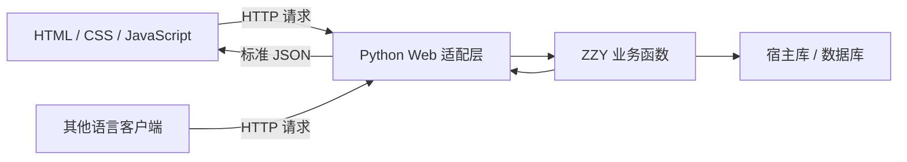

# ZZY 性能与稳定性设计

作者：赵梓伊｜更新：2026-10-14｜状态：测量契约；P07 B01—B09 基线与单项优化实测已保存

正式语法见 [syntax.md](../language/syntax.md)，批量接口见 [stdlib.md](../language/stdlib.md)，整体方案见 [design详细版.md](../design详细版.md)，落地顺序见 [interpreter.md](interpreter.md)。本轮实际数据见 [performance-report.md](performance-report.md)；其余候选收益仍待测，不以设计文档代替证据。

目标是让 ZZY 比自己的初版更快，尤其是在循环和批量数据处理上。Python 宿主不妨碍优化，但不应先承诺超过 Python：具体提升取决于实现和任务。

本文按解释成本、减少重复工作、测量与正确性、可选后续归类。性能报告已单独编写，本文保留测量规则与尚未采用的候选设计。

## 1. 语言设计与解释成本

### 1.1 为什么初版可能慢？

如果一段 ZZY 循环执行一百万次，树遍历解释器需要反复识别语法树节点、查找变量、检查类型和调用执行函数。这些工作发生在实际加法之外。

给关键字加括号主要改变源码识别方式：程序可以先解析一次再运行，不需要每轮循环重新读取 `(for)`。因此括号语法本身不是主要优化目标。

### 1.2 更长的关键字和颜文字转义，会影响性能吗？

会增加一点源码扫描工作，但不必增加循环里的执行成本。`(zif?:)` 解析后变成固定的分支节点或指令，执行器处理条件与跳转，不再逐字辨认这个关键字。

`[OoO]` 也采用同样的思路：普通字符串加载时解码一次，例如 `"A[OoO]nB"` 变成包含换行的字符串；运行时直接使用结果。与单字符转义前缀相比，源码更长，扫描时多检查几个字符，具体成本可以单独测量，但它不是每次打印、循环都重新支付的成本。

设计时做到三点：固定符号表、按首字符和最长匹配扫描、避免全局反复替换。原样字符串 `(raw)"..."` 跳过转义，运行时接收到的 JSON 字符串也不当成源码解码。

新注释采用 zzysay:/zzysayalot: … zzyend。正常模式扫描完整名字后确认紧邻冒号，随后直接跳过注释正文；多行结束词检查边界且搜索指针持续前进。标记更长会增加同一程序的源码长度，但固定标记、不嵌套的注释仍可设计成随源码长度线性增长的扫描。它不产生运行时注释判断，也不预先保证比单字符注释更快。

普通转义符通常是 `\`，ZZY 的 `/` 仍负责除法，字符串中的 `/` 仍为普通字符。这样 URL 与 HTTP 路径无需额外处理。语言转义只控制源码表示；发送 JSON 时采用标准序列化，不给其他语言引入 `[OoO]` 规则。

## 2. 减少重复工作与已选功能成本

### 2.1 能不能自己设立一些库？可以，而且值得优先做

| 库的实现方式 | 能带来什么 |
|---|---|
| 用 ZZY 写 `campus.zzy` 等库 | 复用业务逻辑，减少重复代码；不会因为叫“库”就自动变快 |
| 用 Python 写 ZZY 内建库 | 将大量 ZZY 语句变成一次宿主调用，减少逐条解释开销 |
| 接入 NumPy 等已编译库 | 把大批数值运算交给底层实现，可能进一步加速，但需要数据转换 |

例如同样对整数数组求和：

```text
zzysay: 普通 ZZY 循环：每个元素都执行解释器中的赋值与加法
(zyes) total := 0;
(for) number (in) numbers {
    total <- total + number;
}

zzysay: 内建库：一次进入宿主实现，完成整批求和
(zno) fast_total := array.sum(numbers);
```

`array.sum` 的宿主包装先确认非 Bool 的 Int 元素，再进行受资源限制的精确整数累加；只有能保证部分和与临时分配不越界时才使用 Python `sum` 快路径，不能仅在返回后检查最终总和。`array.sorted` 先按契约确认全 Int 或全 String，再调用稳定排序返回新数组。参考 [Python 内建函数文档](https://docs.python.org/3/library/functions.html)。

求和进行 O(n) 次加法，类型检查也是线性遍历；比较排序通常需 O(n log n) 次比较，不能把两者都写成 O(n)。任意精度整数的加法/比较还受位数影响，字符串比较受公共前缀长度影响，因此这些是操作次数，不能无条件当作耗时。宿主批量库主要减少逐项执行 ZZY 节点的开销，没有把工作量变成 O(1)。

当前 sum/stats 明确只支持 Int。浮点加法顺序影响舍入，Python 3.12 起 sum 的浮点算法也改变；不能把手写左折叠偷偷替换成宿主 sum 并保证逐位等价。未来浮点聚合应单独命名/定义算法，两边采用同一算法和误差标准。[官方 sum 版本说明](https://docs.python.org/3/library/functions.html#sum)

第一批库按现有标准库契约实现，不从概括性描述推断新接口：

- `array`：sum/stats、sorted、copy/push/pop、map/filter；最值和数量由 stats 提供，排序返回新数组。
- `text`：trim/join/split/contains/replace/safe_int；大量文本优先一次 join。
- `math`：当前只登记 abs，不将“常见数学运算”当成已定签名。
- `data`：Map 与 JSON 编解码；文件读写归 io。
- `io`：print/input、UTF-8 文本读写与原子保存；仍按既定参数和输出协议调用。
- `unit`：make/format，按精确数量契约转换和显示。

内建库必须保持 ZZY 的类型和错误规则。例如布尔值不能偷偷当整数，数组检查不能漏掉，排序不能悄悄改变原数组。只暴露明确注册的接口，无需让 ZZY 程序任意执行 Python 代码。

小批量可能被检查、转换和调用开销抵消，所以库的收益应测量。`array.filter` 如果每个元素都回调一个 ZZY 函数，仍然有逐元素解释开销；它和专门的批量数值函数不是同一种加速。

### 2.2 其他优化：先减少重复工作

| 方法 | 容易理解的做法 | 适用范围 |
|---|---|---|
| 预解析与解析缓存 | 程序先解析一次；重复加载时复用解析结果 | 降低启动或加载成本，不直接加快每次加法 |
| 提前定位变量 | 把变量名提前对应到局部槽位，执行时直接取值 | 减少循环和函数中的重复名称查找 |
| 常量折叠 | 将字面量组成的 `2 + 3 * 4` 预先算成 `14` | 减少确定不变的运算，保留原来的类型和错误行为 |
| 显式延迟缓存 | 用 `(zzz)` / `wake` 只计算用到且会复用的结果 | 避免无用或重复计算；缓存不会自动更新 |
| 少创建临时对象 | 操作数据时减少不必要的复制和中间数组 | 降低分配开销与内存占用 |

槽位像“提前给变量编号”，减少每次按名字找字典。闭包和 Lazy 捕获的可变绑定都须共享 Cell，每轮循环绑定仍独立。这种实现思路参考 [Crafting Interpreters 的局部变量章节](https://github.com/munificent/craftinginterpreters/blob/master/book/local-variables.md)。

Program 缓存键包含规范路径、源码内容、语言版本、编译选项、宿主 ABI 与依赖版本；不能复用上次的模块实例、变量、Lazy、函数或结构默认值的捕获环境。函数结果缓存还需保持对象身份与引用语义：即使一个函数无副作用，每次返回新数组也不能改成返回同一个缓存数组。候选范围先限为已证明稳定、无外部读写的标量参数和标量结果，参考 [Python 的缓存说明](https://docs.python.org/3/library/functools.html#functools.lru_cache)。

缓存有条目/字节上限，按测量选择淘汰；仍在运行的 Program 由上下文持有，不因淘汰失效。哈希与解析使用同一份读取快照，依赖变化重建整个对应准备结果。Token/span 尽量引用源码，行索引一次构建；Unicode 名字按固定长度字符判定，不反复扫描增长的名字前缀。

### 2.3 一个 ZZY 风格的小创意

`array.stats(numbers)` 的契约为一次遍历检查 Int 并算出数量、总和、最小值和最大值，返回新的 `array.Stats` 结构。空数组 count/sum 为 0，min/max 为 Null；不修改输入，不缓存统计值。

```text
(zno) report := array.stats(numbers);
io.print(report.sum);
io.print(report.max);
```

减少遍历有明确价值，但一遍 Python 循环仍可能慢于多次高效宿主函数。计入检查、调用和结果构造成本，用相同数据测量，不能只凭遍历次数证明更快。

### 2.4 已选 C/D 的扫描成本与运行成本

规则见 [machine-units.md](../features/machine-units.md)。状态机增加固定 `(machine)`、`-->`、`--`、`<<`，数量沿用已有 `::` 加普通单位标识符。Lexer 只负责最长匹配和原文定位，不在每个字符位置识别完整状态图、查变量或计算量纲。单位数字保留原文，准备阶段按节点转换一次。

新增符号会增加分派和源码扫描的常数成本，线性扫描目标不因此改变；匹配长箭头优先，多行注释候选仍单向搜索。分别记录源码字节/码点/Token 数、词法与解析准备耗时，比较含状态图/单位的大文件和原有普通代码，不能只看字符数相同或只看总 run。

状态图一次构建不可变转移表，发送查询当前状态/事件并写实例；图准备与成功/失败发送分别计时。查表不意味着任意长度事件都绝对 O(1)，字符串哈希和实例检查仍有成本，不在每次事件重新扫描箭头。

Quantity 的主要额外成本是精确有理数运算和约分。单位倍率/量纲表预建，字面值只准备一次；用同样的精确有理数、量纲规则和操作数位数做 Python 对照，同时测小数、派生量纲及增长中的分母。不能降低为 Float 或省类型/资源检查来换性能数字。

C/D 的设计价值是流程和量纲约束，B08/B09固定工作量已有P07实测及超时记录，其他工作量未测；C/D 已选定，A 在 v0.6 也已采用，B 仍未进入语言。

### 2.5 已选 A 的查询成本

规则见 [query.md](../features/query.md)。`?>` 和条目关键字是固定 Token，@ 的作用域交 Parser/Resolver，不在扫描时识别数据类型。QueryExpr 可准备一次复用，源、快照、take、当前项、排序键和输出每次独立。

基线完整浅快照和筛选 n 项，保留 k 项各求键一次，稳定排序再截取并投影 r 项。收益目标是固定计划减少重复 AST 分派/键计算，不是自动将排序降成线性。Python 对照也采用相同快照、类型/量纲校验、完整阶段与稳定性，复位范围相同。

分别测无序/有序、稳定重复键、不同选择率、空输入和 take=0，记录源码/Token 数与词法、准备、执行、内存。条目纯也可能除零或错字段，第一版不提前终止筛选、不自动堆 top-k、不重排阶段，不靠隐藏后段错误赢速度。库函数封装复用代码和 AST，不自动缓存旧结果。

### 2.6 已选 E 的绘图成本与稳定性

[sketch.md](../features/sketch.md) 不新增核心词法规则；sketch.xxx 是普通调用，图案文件是数据，不按 ZZY 源码扫描。注册元数据与 GUI 依赖分开；headless 生成/导出不 import Tk，普通启动不先创建窗口。

批量折线少跨宿主边界；历史保存增量，共享只读路径块，缓存按文档版本/几何精度失效且有界。定位回放用共享检查点，不为每步复制整图。刷新合并只改变显示调度，输入保序、几何记录完整；超额提前拒绝操作，关闭/取消不等满队列，避免内存增长或窗口线程互等。

分别测 1,000/10,000/100,000 笔画的脚本执行、记录、渲染、撤销/定位、SVG/项目/函数导出及峰值内存，首次图案解码与 Lazy 命中单列。多图层/曲线展开/历史空间同样计入；Python 对照同几何、容差、历史和导出工作量，turtle 的逐笔动画耗时不冒充解释器计算性能。帧率/加速比尚未测得。

## 3. 可复现测量与正确性门槛

### 3.1 如何知道优化有效？

先用 `cProfile` 找出解释器把时间花在哪里，再用独立计时测速度。性能分析器用于找瓶颈，会影响运行时间，不适合直接当最终基准结果。[Python 性能分析文档](https://docs.python.org/3/library/profile.html)

保留三组比较：

1. **解释器优化**：初版 ZZY 与优化版 ZZY，运行同一脚本。
2. **作业基础比较**：ZZY 与 Python，采用同算法、同输入、同结果。
3. **库功能比较**：ZZY 调用内建库，对照 Python 调用等价的库；NumPy、缓存和转换成本两边都对应计入。

使用 `time.perf_counter` 或 `timeit` 独立计时，预热后重复运行，记录多次结果和中位数；分别看“启动加解析加执行”与“纯执行”。测试前先核对结果，循环内避免大量打印。[timeit 文档](https://docs.python.org/3/library/timeit.html)

推荐实现顺序：**P01/P02 跑通初版 → P03 完成槽位与捕获 → P05 完成宿主库 → P06 补齐测试 → P07 固定基线、测量并优化 → 按热点决定是否进入 P10 字节码。** 开发途中可做小测量，但不把槽位和必需库推迟到 P07；若要比较迁移收益，保留早期版本，用两版共同支持的脚本单列结果。阶段依赖以 [roadmap.md](../development/roadmap.md) 为准。

### 3.2 可复现测量契约

1. **先固定工作量。** 同一算法、输入、结果与库策略；基础基准不使用 ZZY 库对比 Python 手写循环。整数按精确值校验，浮点采用同算法并预先定义误差标准。结果校验不混进计时。
2. **分开计时范围。** 端到端从父进程发起 CLI 到结束，包含启动/加载/初始化/执行；执行阶段两边预载程序，调用对应任务函数。输入构造与状态复位是否计入必须两边相同。ZZY 排除解析时，Python 也排除对应编译/加载，不只替一边减成本。
3. **每次恢复状态。** 同样输入不等于同样初态，排序后的数组、Lazy 缓存、文件和数据库不得进入下一次当新输入。缓存实验单列首次和命中成本，普通基准不混入上一轮 Lazy 命中。重建若在计时外也记录开销。
4. **重复与交错。** 建议先 3 次预热，再至少 15 次独立样本；短任务批量运行至样本约 100ms 以降低计时噪声，记录实际策略。版本/语言按记录种子交错顺序测，避免总把一个版本放在系统更热的时候。记录中位数、最小值与 MAD 等离散程度，保存全部原始样本；差异接近噪声时不宣称提升。
5. **记录环境和来源。** OS/CPU/内存、Python 与依赖版本、Git 提交、工作树是否脏及补充 diff、输入规模/种子、启动命令、计时器、预热/样本数、缓存/GC 策略。新进程不等于磁盘页缓存已冷，不虚称冷启动。
6. **分析单独进行。** cProfile、观察、tracemalloc 与正式速度计时分开；tracemalloc 主要观察 Python 分配，不能当全部原生内存或峰值 RSS。内存测量另列工具与范围。

优化加速比为 `T_before / T_after`，大于 1 才更快；作业对照比为 `T_ZZY / T_Python`，大于 1 表示 ZZY 更慢。不要混淆分母，也不把不同任务加速比简单平均成总性能。

建议原始数据表包含：case、algorithm、input_size、seed、language、revision、timing_scope、cache_state、sample_index、elapsed_ns、result_check、environment_id。端到端、执行、库调用分别报告。

### 3.3 优化的正确性门槛

常量折叠只处理会成功的纯标量字面量运算；保留源码位置。死分支的 `1/0` 和错误类型不能在 check 或加载时提前报错；数组字面量不能折叠成跨调用共享对象。限制折叠大小，避免编译阶段制造巨量整数/字符串。

候选超出优化预算或出现预期求值诊断时回退为原节点，实际执行时仍按原位置/顺序检查；优化预算不是用户程序的新失败条件。源码/语法本身的资源上限与折叠预算分开；核心分配限额在 P00—P05 建立，不等待可选 P10 的请求步数配额。大数/Quantity 约分、排序比较、JSON 编解码和宿主批量操作的中间空间也受限。

不要把 `0 * f()`、`x - x`、`f(@)` 的重复调用等“数学上相同”直接删掉，函数可能打印、修改状态或失败。管道融合需保持阶段、回调及异常顺序，第一版不自动融合。

每项优化先过 [test-coverage.md](../development/test-coverage.md) 的值、I/O、错误和引用边界，再测性能；可选 VM 使用同一语义规则，配额不能简单按指令条数改变。正确但无收益的优化可以撤回，不能为速度改弱契约。

### 3.4 P07 的第一批可执行基准清单

以下 ID、规模和工作量是已落实的固定起点，配对文件放 `benchmarks/zzy/` 与 `benchmarks/python/`，清单放 `benchmarks/cases.json`；脚本、原始记录与失败范围见性能报告。两边使用相同递增循环、检查和结果规则，禁止临时换成只对一方有利的算法。每组先验证小规模固定答案，再运行列出的三档规模。

| ID / 类别 | 工作量和 n | 结果校验与对照 |
|---|---|---|
| B01 / 基础算法 | while 累加 0 至 n-1；n=1,000/10,000/100,000 | 精确等于 n(n-1)/2；两边逐项整数加法，不用 Python sum/公式代替被测循环 |
| B02 / 基础算法 | 调用同一个 `inc(x)=x+1` 函数 n 次并累加；同 B01 三档 | 结果 n(n+1)/2；每次确实调用，不仅 Python 一侧内联 |
| B03 / 基础算法 | 遍历已有数组 [0,...,n-1] 逐项累加；同三档 | 与 B01 同答案；两边手写遍历，排除数组构造的执行计时中另列构造成本 |
| B04 / 等价库 | 对同一类型规则的整数数组调用 array.sum；同三档 | Python 包装同样排除 Bool/非 Int 并使用相同部分和资源检查；裸 Python sum 可另列参考，不充当等价检查组 |
| B05 / 等价库 | 稳定排序逆序且含重复值的数组，元素为 `(n-1-i) % 97`；同三档 | 对照全序列、各值频数、输入未变；两边同校验/复制/稳定排序范围，不只验证总和 |
| B06 / 前端成本 | 生成 n 条不同名称的标量声明，n=100/1,000/10,000 | run 均只输出 n-1；固定等价源码生成器与文件哈希，分开记录读取/词法/解析/绑定与端到端成本 |
| B07 / A 查询 | Task 数组按未完成筛选、优先级 desc、take=10、yield=id；n=1,000/10,000/100,000 | 同浅快照、完整筛选/键校验、稳定排序/截取；相同优先级保持输入 id 次序，Python 不提前 top-k |
| B08 / C 状态机 | 两状态交替发送合法事件 n 次；n=1,000/10,000/100,000 | 成功计数 n，终态按 n 奇偶确定；Python 同转移查表、Result 工作和状态更新，准备图不混入执行时间 |
| B09 / D 数量 | 从 0::s 依次加 1::ms 共 n 次；同三档 | 精确等于 n/1,000 秒；Python 使用等价有理数和量纲检查，不用 Float 代替 |

B07 使用独立的基准结构（id/done/priority），不套用 P09 应用的文件字段限制。输入固定为 id=i、done 为 `i % 3 == 0`、priority 为 `i % 5`，无随机输入；Python 使用等价固定记录，n=10 时输出 id 为 [4,8,2,7,1,5]。固定答案在计时外逐项比较。较大三档的 100,000 条结构还会占用对象和槽位；若 default-v1 容量不足，记录资源失败并在单独明确配置下重跑，不静默减少元素或放宽限制。

B01—B06 为最小报告集；B07—B09 在已选 A/C/D 实现后分别报告其额外成本。量纲、查询、绘图等工作负载不与整数循环混成一个平均排名。优化对照复用适用的 ID，只改变被测优化；若没有验证有效的优化，保留零收益/退化结果，作业所需 ZZY/Python 对照仍须完成。

### 3.5 计时入口、状态复位和可复现清单

P07 使用独立的 Python 基准驱动，直接调用已有解释器内部“准备 Program / 建立 ExecutionContext / 初始化模块 / 调用函数”路径；这不是对外 Python 嵌入 API，不依赖可选 P08，也不允许 Python 重写 ZZY 被测算法。具体内部函数名已记录到 cases.json 的 internal_entrypoints，基线另存 driver-entrypoints.json 补充说明。

| timing_scope | 开始与结束 | 必须公开的排除项 |
|---|---|---|
| cli_total | 父进程启动 CLI 前至回收进程、读完输出后 | 文件生成在外；执行入口须包括本组约定的输入构造/模块初始化 |
| execute | 已准备 Program 和独立初态后，任务函数入口至返回 | 读取、编译、初始化、输入构造、清理分别记录；Python 同样排除对应工作 |
| prepare | 持有同一源码字节快照后至完成 Program | 排除文件读取，读文件另列；Python 对照明确含编译或其他等价准备，阶段不能硬凑一一对应 |

每个样本使用新状态；批处理短任务以接近 100ms 时，批内每次调用也须满足同一初态，不共享可变数组、Lazy 或状态机。若重建操作无法可靠放在计时外，则两边一起纳入并改写清单的计时范围，不能只减去估计开销。输出/完整结果校验在计时外；若所测工作量本来包括输出或编码，保留在内并单独分类。

清单 `schema_version=1`，每例至少含 id、category、zzy_file、python_file、algorithm、sizes、input_definition、expected_result、timing_scopes、setup/reset/teardown 边界、warmups=3、samples=15、sample_timeout_seconds=30、有效资源配置及其哈希。文件或字段缺失、结果不符、超时和资源失败均单列，不能记成 0ms 或从报告无声删除；必要时调大超时，作为新配置实验记录。

运行元数据补充 Python 实现/完整版本、Unicode 数据版本、OS/CPU、核心与库版本、扩展启用状态、Git 修订/未提交差异、GC 策略、顺序种子 20261008 和实际运行顺序。首轮默认 GC 启用，两边一致；测关闭 GC 时另列实验并明确设置，不直接依赖计时工具的隐含默认。n(n-1)/2 等公式只作结果校验。

原始 CSV/JSONL 保存每个样本和失败状态；报告对应运行清单与环境快照。资源策略来自 [resources.md](resources.md)，配置不同的结果不得直接标为某项优化的前后加速比。

## 4. 可选后续优化与互联

本组仍是候选：P08 在 P09 后实施，P10 按相应基础/热点选择；不是核心性能基线的前置条件。

### 4.1 再进一步：字节码和可选数值库

**字节码**是将语法树变成更简单的执行指令，比如“取变量、加一、存变量、跳转”。它可能减少节点遍历和层层调用；依然由解释器执行，所以不违背解释型语言的作业要求。Python 写的虚拟机是否更快仍需测量，也不意味着自动超过 CPython。参考 [Crafting Interpreters 的字节码介绍](https://github.com/munificent/craftinginterpreters/blob/master/book/chunks-of-bytecode.md)。

**数值库**可以封装 NumPy，例如 `num.dot(a, b)` 做向量点积。NumPy 的批量运算可以交给已编译的代码执行，适合较大的同类型数值数组。[NumPy 官方解释](https://numpy.org/doc/stable/user/whatisnumpy.html)

它需要考虑转换成本；固定宽度整数也可能溢出，而普通 ZZY 的 `Int` 计划支持任意精度，因此数值库应明确自己的类型规则。另外，`numpy.vectorize` 主要提供方便的调用形式，不能当成自动加速任意 ZZY 回调的工具。[官方说明](https://numpy.org/doc/stable/reference/generated/numpy.vectorize.html)

第一版建议先用 Python 标准库做宿主内建函数；字节码和 NumPy 留到热点明确后选择实现。

### 4.2 内容版本的数组类型校验缓存

重复对同一个未修改整数数组调用 sum 时，完整类型扫描会重复发生。可以缓存该数组在某个 content_version 下通过“全部 Int、排除 Bool”的判定；下一次只比较版本，再执行求和。它缓存的是类型证据，不是数值结果，求和仍需 O(n) 次加法，各次加法成本取决于整数位数；资源检查也不能因类型缓存命中而跳过。

缓存键为对象身份、content_version、校验谓词/语言版本；放在 ArrayValue 的有界元数据中，不用可能保留大量数组的全局字典。只缓存成功判定。所有元素替换、增删/重排与宿主写入都更新内容版本，别名写入也一样；校验期间不允许绕过写接口访问裸 Python list。

场景对照至少含小/中/大数组、一次调用、同数组反复调用、每次都修改元素四组。记录校验命中率、扫描次数、总时间、额外内存和写入开销；修改后必须先重新检查。未修改场景有收益、频繁修改场景退化时如实报告，可保持关闭。未实现所有写入口的失效逻辑前不启用该缓存。

### 4.3 让 ZZY 成为能连接前端的后端语言

#### 4.3.1 可行，而且不需要前端也使用 ZZY

HTML 构建页面，CSS 管样式，JavaScript 或表单发送请求。ZZY 后端通过 HTTP/JSON 返回数据，Python、Java 等其他程序也能调用同一接口。[Fetch 使用说明](https://developer.mozilla.org/en-US/docs/Web/API/Fetch_API/Using_Fetch)



最实用的第一版是使用 Python 的 FastAPI/Starlette 桥接 ASGI 服务器：网络连接交给成熟框架，自己的解释器执行 ZZY 函数。`web.get` 等是宿主库接口，无需为每种协议新增关键字。[ASGI 规范](https://asgi.readthedocs.io/en/latest/specs/main.html)、[FastAPI 响应说明](https://fastapi.tiangolo.com/advanced/custom-response/)

同一个解释器还可以提供 Python 嵌入接口，例如“加载模块、调用导出函数、转换返回值”，让现有 Python 项目使用 ZZY 写规则或业务插件。跨进程先使用 HTTP/JSON；本地宿主先做明确注册的 Python 函数桥接，无需第一版就实现任意 C/Java 对象的直接调用。

#### 4.3.2 拟议的最小前后端示例

ZZY 后端：

```text
(shape) Greeting {
    language: (String);
    message: (String);
}

(addnew) hello(request) {
    (return) web.json(Greeting::{
        language: "ZZY",
        message: "你好，前端！",
    });
}

web.get("/api/hello", hello);
web.serve("127.0.0.1", 8000);
```

网页中的 JavaScript：

```javascript
async function showGreeting() {
    const response = await fetch("/api/hello");
    if (!response.ok) throw new Error(`HTTP ${response.status}`);
    const data = await response.json();
    document.querySelector("#message").textContent = data.message;
}
```

网页准备一个带 `id="message"` 的元素，再调用 `showGreeting()`。示例假定页面与 API 同源，例如适配层同时提供静态页面；开发时若来自不同端口，应使用代理或配置对应来源的 CORS，不能靠 `no-cors` 读取响应。[CORS 说明](https://developer.mozilla.org/en-US/docs/Web/HTTP/Guides/CORS)

以上只是拟议接口，当前还没有服务可以启动。它展示的是：ZZY 不必理解 HTML/CSS 的语法，也能为页面提供功能。

#### 4.3.3 后端性能应该优化哪里？

- **启动时加载一次**：路由、模块、结构布局、AST 或字节码预先准备，请求不再反复解析源码。
- **请求状态独立**：每次调用独立 ExecutionContext；共享模块、嵌套容器与默认捕获环境递归冻结。模块级 Lazy 和捕获可变状态的共享闭包拒绝或归每请求实例；业务状态使用数据库。
- **数据库和序列化交给库**：JSON 转换、SQL 查询等通过宿主实现；初版 SQLite 使用参数化查询与事务。[Python sqlite3 文档](https://docs.python.org/3/library/sqlite3.html)
- **同步与并发分清**：同步 ZZY 计算使用框架的同步入口或受控执行池；不直接阻塞异步事件循环。线程并不承诺提升普通 Python CPU 密集执行速度，多核计算可用独立进程 worker。[FastAPI 并发说明](https://fastapi.tiangolo.com/async/)

JSON 边界按标准库契约：结构转对象，Array/Map 等按标准编码；Function、任何 Lazy、Result、Range、Machine、Quantity、模块、结构/状态机定义、绘图原生句柄和循环引用均拒绝，嵌套值也执行相同检查。HTTP 默认拒绝安全整数范围之外的 Int，只有显式约定的十进制 String 字段进行双向转换，不因数值大小改变字段类型。解析重复键、NaN/Infinity 和溢出 Float 也要拒绝。[RFC 8259 数字互操作范围](https://www.rfc-editor.org/rfc/rfc8259.html#section-6)

网络吞吐量与语言计算速度分别测量。后端测响应延迟、吞吐量及并发正确性，计算基准继续测解释器；“能提供接口”不等于“所有请求都比其他后端更快”。

### 4.4 其他更有实现深度的创新

这些是借鉴已有工程理念的 ZZY 扩展，不声称世界首创。建议挑一两项完整实现并演示，其他保留为路线图。

| 创新 | 做法与实际价值 | 实现成本 |
|---|---|---|
| **结构驱动的接口合约** | 用 `(shape)` 描述请求和响应，一次生成字段校验器、JSON 编解码布局、OpenAPI 和前端 TypeScript 类型，减少前后端字段不一致 | 中 |
| **带守卫的执行快路径** | 已标注整数的局部槽位、已知结构字段使用专用指令；条件不满足时回到通用检查或报原有类型错误 | 中到高 |
| **每请求执行配额** | 解释器或 VM 记录步数、调用深度和期限，超出时中止该请求，避免无限循环占住服务 | 中 |
| **可验证的纯函数缓存** | 把输入输出、时间、随机和数据库操作标成有副作用；只缓存可验证且结果稳定的函数 | 高 |
| **按版本切换模块** | 新源码先解析、检查和生成程序快照，成功后切换路由；在途请求继续使用旧版本，错误更新不替换现有版本 | 高 |

**Web 扩展最推荐接口合约。** 固定字段支撑前端提示和请求校验。具体类型范围、缺失与 Null、标量默认值和生成一致性按 [innovation.md](../features/innovation.md) 第 4.3 节“一份 shape，多处对齐”执行，不能假定 Array 自带元素类型，不能执行任意默认表达式生成规范。OpenAPI 可由其他语言工具消费。[OpenAPI 规范](https://spec.openapis.org/oas/v3.1.1.html)

**执行快路径要保留语义。** 字段编号可以避免反复按字段名查找，整数加法指令可以减少通用分派；但不能把任意精度整数偷偷变成会溢出的机器整数，也不能仅凭注解删除所有检查。这是局部专门化，不是已经拥有完整 JIT。

**执行配额适合自己的解释器。** 可以先限制 ZZY 步数，再加入期限。步数无法中断已经进入的耗时宿主函数，因此数据库、网络库要有自己的超时；需要硬性终止的任务放在可结束的独立进程中。一次指令的成本并不相同，步数上限不等于精确的 CPU 时间保证。

**纯函数缓存必须明确边界。** 第一版可只支持标量参数、标量结果，以及能确认没有外部读写的函数；回调行为不明、闭包捕获可变值时不启用。不能缓存一次写库或读输入的操作，然后让下一次调用跳过它。

**模块切换保留版本边界。** 程序及其依赖一起建立快照，缓存按版本隔离；数据库结构变更另行处理。它用于减少开发重启和保留可复现版本，不自动解决分布式更新。

推荐组合是：**Python 宿主批量库 + 预解析和槽位定位 + HTTP/JSON 桥接 + 结构驱动接口合约**。有余力再加执行配额或专用指令。这样既有可测量的性能工作，也有适合后端与其他语言协作的功能。

后端组合适合完整 CLI 应用之后的扩展，不成为 P09/P11 前置条件。核心阶段先交付正确解释器、黑盒集与真实性能报告。


Sketch独立扩展的1000/10000/100000线段、单笔/批量/多笔多层、真实GUI、历史与图案测量见[Sketch性能报告](../../benchmarks/sketch/README.md)。该报告保留配对算法、准备/执行、原始样本和资源失败，不将turtle动画时间作为解释器对照。
